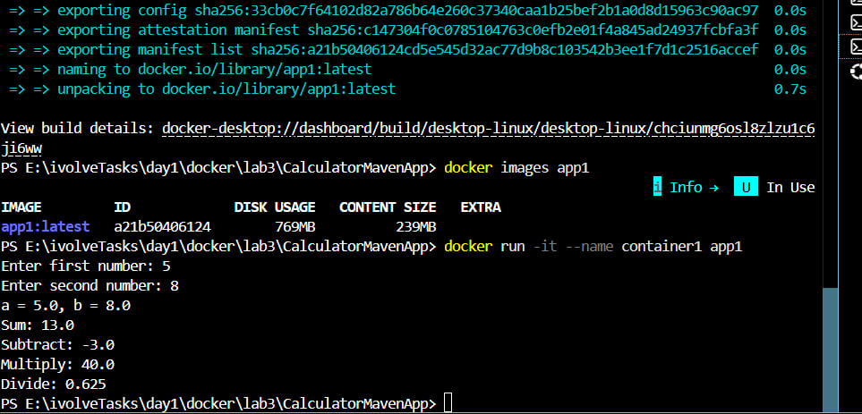
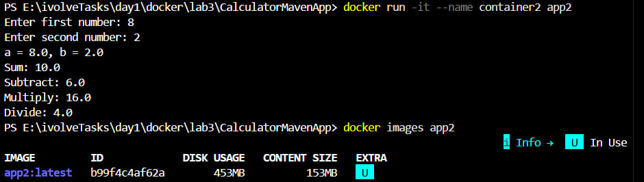

# Lab 3 - Creating a Docker Image for a Java Application

## Description

A Java Calculator application containerized using Docker in two different approaches.
The goal is to understand the difference between building inside Docker vs building locally,
and how each approach affects the final image size.

---

## Environment

- OS: Windows 11 with Docker Desktop
- Docker version: 29.8.0
- Java: OpenJDK 17
- Maven: 3.9.6
- Working directory: `E:\ivolveTasks\day1\docker\lab3\CalculatorMavenApp`

---

## Source Code

Cloned from: https://github.com/Ibrahim-Adel15/CalculatorMavenApp.git

---

## Part 1 - Build Inside Docker

In this approach, Maven and the build process run **inside** the Docker container.
The base image includes both the JDK and Maven tools.

### Dockerfile

```dockerfile
FROM maven:3.9.6-eclipse-temurin-17

WORKDIR /app

COPY . .

RUN mvn package -DskipTests

CMD ["java", "-jar", "target/calculator.jar"]
```

### Steps

```powershell
# Build image
docker build -t app1 .

# Check image size
docker images app1

# Run container
docker run -it --name container1 app1
```

### Output

Screenshot:



### Results

| Property | Value |
|----------|-------|
| Image Name | app1:latest |
| Image ID | a21b50406124 |
| Disk Usage | 769MB |
| Content Size | 239MB |

### Cleanup

```powershell
docker rm container1
docker rmi app1
```

---

## Part 2 - Build Locally

In this approach, the JAR is built **locally** using Maven on the host machine.
The Docker image only contains the Java runtime (JRE) needed to run the JAR.

### Steps

```bash
# Build JAR locally (WSL)
mvn package -DskipTests
```

### Dockerfile

```dockerfile
FROM amazoncorretto:17-alpine3.21-full

WORKDIR /app

COPY target/calculator.jar .

CMD ["java", "-jar", "calculator.jar"]
```

### Commands

```powershell
# Build image
docker build -t app2 .

# Check image size
docker images app2

# Run container
docker run -it --name container2 app2
```

### Output

Screenshot:



### Results

| Property | Value |
|----------|-------|
| Image Name | app2:latest |
| Image ID | b99f4c4af62a |
| Disk Usage | 453MB |
| Content Size | 153MB |

### Cleanup

```powershell
docker rm container2
docker rmi app2
```

---

## Bonus - Image Size Comparison

| | app1 (Build Inside Docker) | app2 (Build Locally) |
|---|---|---|
| Base Image | maven:3.9.6-eclipse-temurin-17 | amazoncorretto:17-alpine3.21-full |
| Disk Usage | 769MB | 453MB |
| Content Size | 239MB | 153MB |
| Size Difference | +316MB larger | baseline |

### Why is app1 bigger?

app1 uses a Maven base image which includes:
- Full JDK (Java Development Kit)
- Maven build tool
- All Maven dependencies cached inside the image

app2 uses a lightweight runtime image which includes:
- JRE (Java Runtime Environment) only
- No build tools, no Maven, no source code
- Only the pre-built JAR file is copied in

### Conclusion

Building locally (Part 2) produces a significantly smaller image because the final image
only needs to run the application, not build it. The build tools and source code stay
on the host machine and are never included in the Docker image.
