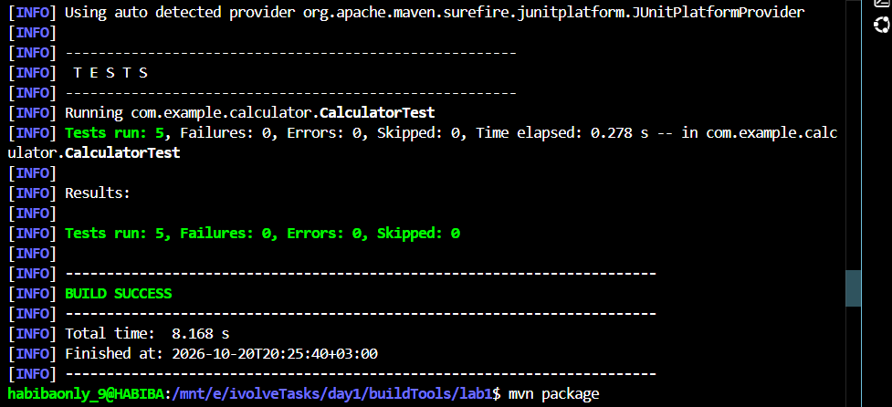
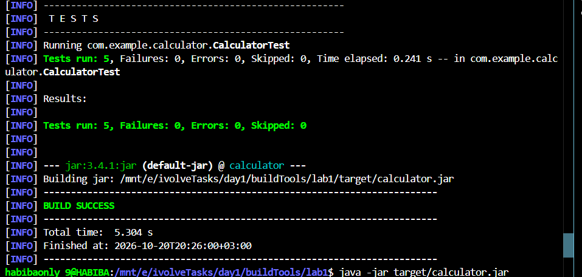
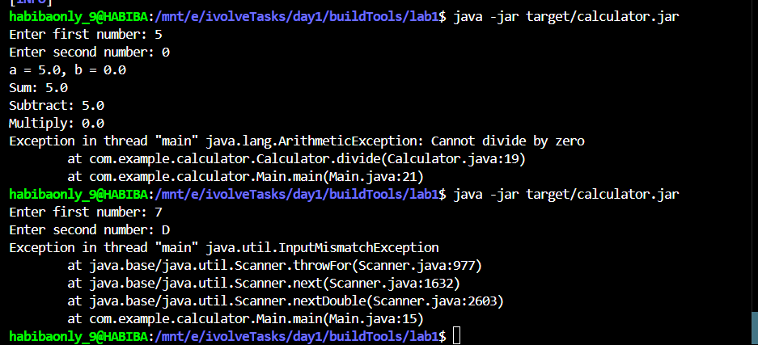

# Lab 1 - Building and Packaging Java Application with Maven

## Description

A Java Calculator application that performs basic arithmetic operations (sum, subtract, multiply, divide).
Built and packaged using Apache Maven as the build tool.

---

## Environment

- OS: Windows 11 with WSL (Windows Subsystem for Linux)
- Shell: bash
- WSL Distro: Ubuntu
- Working directory: `/mnt/e/ivolveTasks/day1/buildTools/lab1`

---

## Prerequisites

- Java JDK 17+
- Apache Maven 3.x

---

## Project Structure

```
lab1/
├── pom.xml
├── src/
│   ├── main/java/com/example/calculator/
│   │   ├── Calculator.java
│   │   └── Main.java
│   └── test/java/com/example/calculator/
│       └── CalculatorTest.java
└── target/
    └── calculator.jar
```

---

## Steps

### 1. Clone the source code

```bash
git clone https://github.com/Ibrahim-Adel15/CalculatorMavenApp.git
cd CalculatorMavenApp
```

---

### 2. Run Unit Tests

```bash
mvn test
```

Output:

```
[INFO] --- surefire:3.2.5:test (default-test) @ calculator ---
[INFO] Using auto detected provider org.apache.maven.surefire.junitplatform.JUnitPlatformProvider
[INFO]
[INFO] -------------------------------------------------------
[INFO]  T E S T S
[INFO] -------------------------------------------------------
[INFO] Running com.example.calculator.CalculatorTest
[INFO] Tests run: 5, Failures: 0, Errors: 0, Skipped: 0, Time elapsed: 0.278 s -- in com.example.calculator.CalculatorTest
[INFO]
[INFO] Results:
[INFO]
[INFO] Tests run: 5, Failures: 0, Errors: 0, Skipped: 0
[INFO]
[INFO] ------------------------------------------------------------------------
[INFO] BUILD SUCCESS
[INFO] ------------------------------------------------------------------------
[INFO] Total time:  8.168 s
[INFO] Finished at: 2026-10-20T20:25:40+03:00
```

Screenshot:



---

### 3. Build the Application (Generate JAR)

```bash
mvn package
```

This generates the artifact at: `target/calculator.jar`

Output:

```
[INFO]  T E S T S
[INFO] -------------------------------------------------------
[INFO] Running com.example.calculator.CalculatorTest
[INFO] Tests run: 5, Failures: 0, Errors: 0, Skipped: 0, Time elapsed: 0.241 s -- in com.example.calculator.CalculatorTest
[INFO]
[INFO] Results:
[INFO]
[INFO] Tests run: 5, Failures: 0, Errors: 0, Skipped: 0
[INFO]
[INFO] --- jar:3.4.1:jar (default-jar) @ calculator ---
[INFO] Building jar: /mnt/e/ivolveTasks/day1/buildTools/lab1/target/calculator.jar
[INFO] ------------------------------------------------------------------------
[INFO] BUILD SUCCESS
[INFO] ------------------------------------------------------------------------
[INFO] Total time:  5.304 s
[INFO] Finished at: 2026-10-20T20:26:00+03:00
```

Screenshot:



---

### 4. Run the Application

```bash
java -jar target/calculator.jar
```

Output:

```
Enter first number: 5
Enter second number: 0
a = 5.0, b = 0.0
Sum: 5.0
Subtract: 5.0
Multiply: 0.0
Exception in thread "main" java.lang.ArithmeticException: Cannot divide by zero
        at com.example.calculator.Calculator.divide(Calculator.java:19)
        at com.example.calculator.Main.main(Main.java:21)
```

Note: The ArithmeticException is expected behavior. The Calculator is designed to throw this exception when dividing by zero.

Screenshot:



---

## Verification

The application works correctly:
- Sum, Subtract, and Multiply operations return correct results.
- Divide by zero throws an ArithmeticException as expected by the business logic in Calculator.java.
