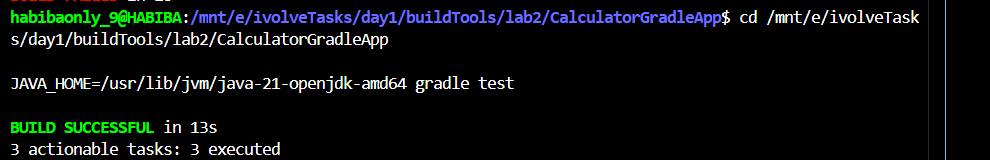
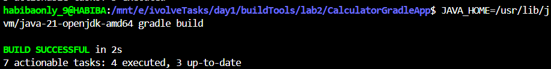
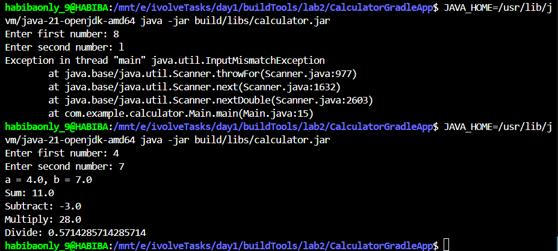

# Lab 2 - Building and Packaging Java Application with Gradle

## Description

A Java Calculator application that performs basic arithmetic operations (sum, subtract, multiply, divide).
Built and packaged using Gradle as the build tool.

---

## Environment

- OS: Windows 11 with WSL (Windows Subsystem for Linux)
- Shell: bash
- WSL Distro: Ubuntu
- Java: OpenJDK 21
- Gradle: 8.7
- Working directory: `/mnt/e/ivolveTasks/day1/buildTools/lab2/CalculatorGradleApp`

---

## Prerequisites

- Java JDK 21
- Gradle 8.7

---

## Project Structure

```
CalculatorGradleApp/
├── build.gradle
├── settings.gradle
├── src/
│   ├── main/java/com/example/calculator/
│   │   ├── Calculator.java
│   │   └── Main.java
│   └── test/java/com/example/calculator/
│       └── CalculatorTest.java
└── build/
    └── libs/
        └── calculator.jar
```

---

## Steps

### 1. Install Gradle 8.7

```bash
wget https://services.gradle.org/distributions/gradle-8.7-bin.zip -P /tmp
sudo unzip -d /opt/gradle /tmp/gradle-8.7-bin.zip
echo 'export PATH=/opt/gradle/gradle-8.7/bin:$PATH' >> ~/.bashrc
source ~/.bashrc
gradle --version
```

---

### 2. Clone the source code

```bash
git clone https://github.com/Ibrahim-Adel15/CalculatorGradleApp.git
cd CalculatorGradleApp
```

---

### 3. Run Unit Tests

```bash
JAVA_HOME=/usr/lib/jvm/java-21-openjdk-amd64 gradle test
```

Output:

```
BUILD SUCCESSFUL in 13s
3 actionable tasks: 3 executed
```

Screenshot:



---

### 4. Build the Application (Generate JAR)

```bash
JAVA_HOME=/usr/lib/jvm/java-21-openjdk-amd64 gradle build
```

This generates the artifact at: `build/libs/calculator.jar`

Screenshot:



---

### 5. Run the Application

```bash
java -jar build/libs/calculator.jar
```

Screenshot:



---

## Verification

The application works correctly:
- Sum, Subtract, and Multiply operations return correct results.
- Divide by zero throws an ArithmeticException as expected by the business logic in Calculator.java.
