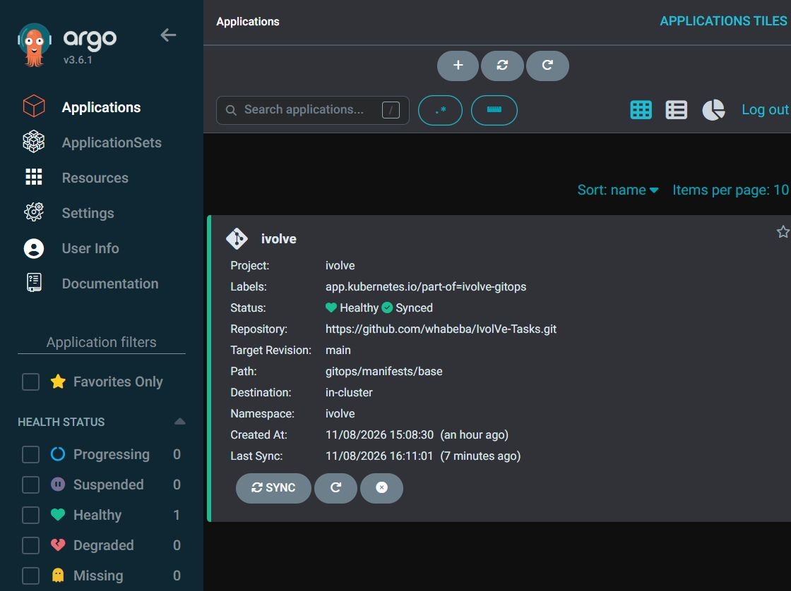
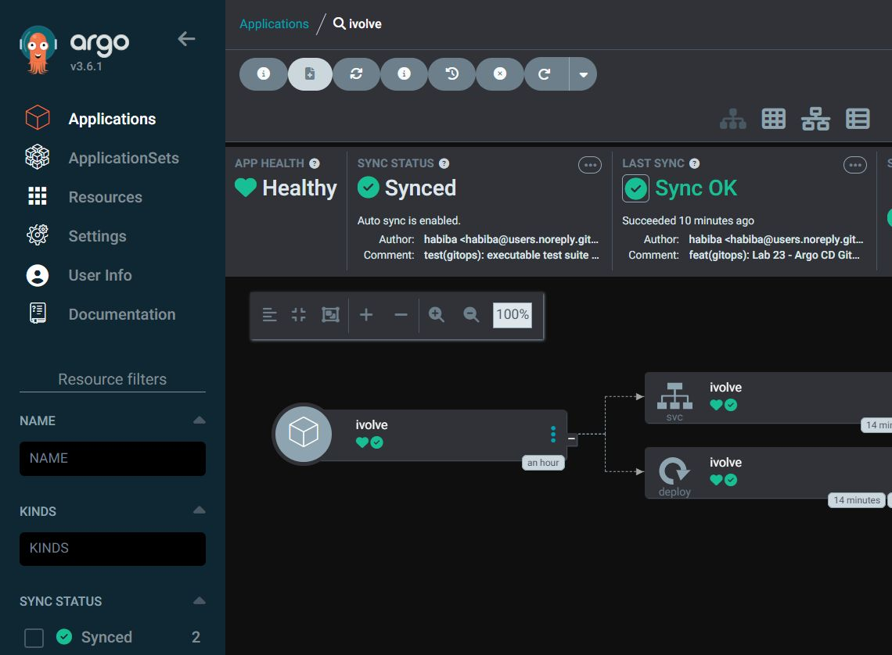
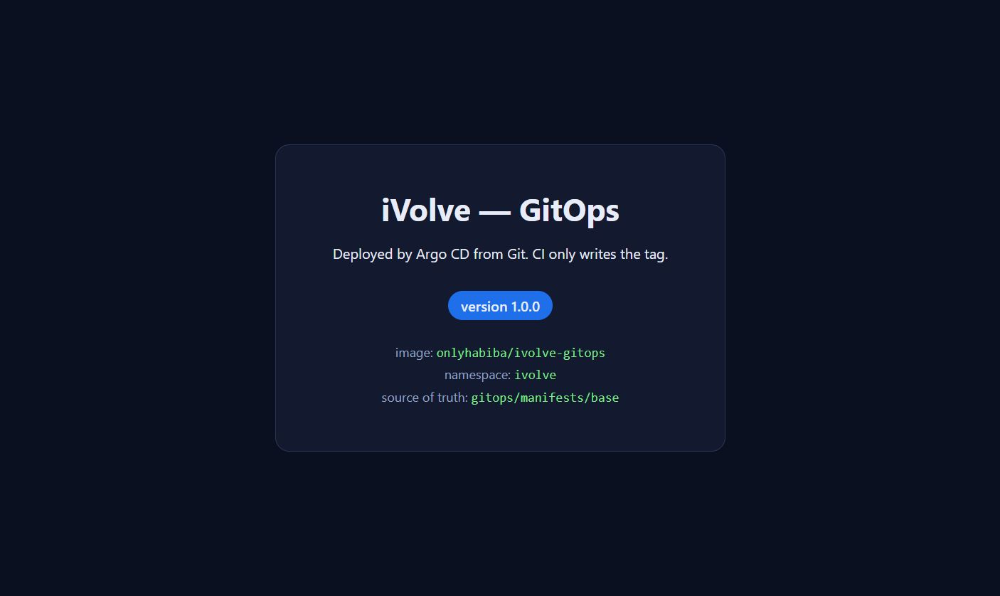
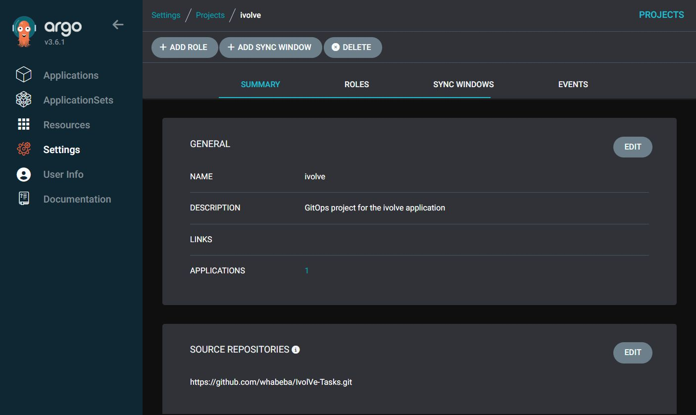
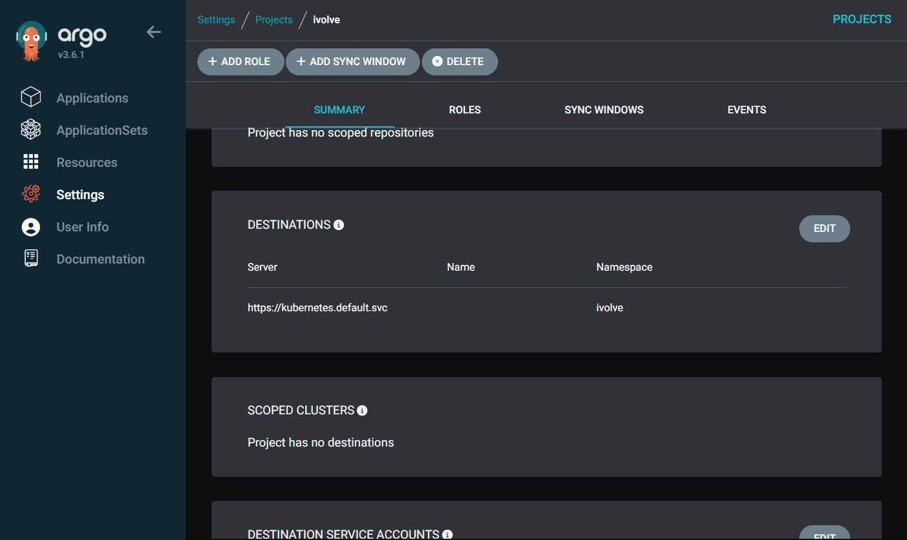

# Lab 23: Implementing a GitOps Workflow with Argo CD

GitOps flips the last mile of CI/CD: **the CI server never touches the cluster**.
It builds the image and writes the new tag into Git. **Argo CD** is the only
component with cluster credentials, and it continuously reconciles the cluster
against Git.

The lab sheet names Jenkins as the CI. Here the CI half is implemented with
**GitHub Actions** (the repository is public, so it is free and needs no server),
and `gitops/Jenkinsfile` is kept as the equivalent Jenkins implementation — the
GitOps contract is identical either way.

---

## Architecture

```
  developer          GitHub Actions (CI)                GitHub
      |                      |                            |
      |  git push            |  docker build && push      |
      +--------------------->|--------------------------->|  Docker Hub
      |                      |                            |
      |                      |  rewrite newTag            |
      |                      +--------------------------->|  gitops/manifests/base
      |                                                   |
      |                                          watch / poll (3 min)
      |                                                   |
      |                                            +------+
      |                                            |
      |                                      Argo CD (in-cluster)
      |                                            |
      |                                   kubectl apply (server-side)
      |                                            |
      +------------------------------------> Kubernetes: namespace `ivolve`
```

**The CI tool is interchangeable.** The contract is only: *build an image, then
commit the new tag*. This repository ships two implementations of that contract:

| File | Role |
|---|---|
| `.github/workflows/release.yml` | **active** — GitHub Actions, no server to maintain |
| `Jenkinsfile` | reference implementation of the same contract (kept for the Jenkins variant of the lab) |

**Key property:** if Git does not change, the cluster does not change. If somebody
changes the cluster by hand, Argo CD reverts it (`selfHeal`).

---

## Repository layout

```
gitops/
├── app/
│   ├── Dockerfile                 # unprivileged nginx, listens on 8080
│   └── index.html                 # __APP_VERSION__ is replaced by CI
├── manifests/base/
│   ├── kustomization.yaml         # the ONLY file CI edits
│   ├── deployment.yaml            # 2 replicas, probes, limits, hardened pod
│   └── service.yaml
├── argocd/
│   ├── project.yaml               # AppProject: least privilege
│   └── application.yaml           # Application `ivolve`
├── tests/
│   └── verify.sh                  # TC-01..TC-15 as executable checks
├── screenshots/                   # evidence, referenced by this README
├── Jenkinsfile                    # optional reference implementation
└── README.md

.github/workflows/release.yml      # the CI that is actually used
```

**How to run it:** **Actions → release → Run workflow** (or push a change under
`gitops/app/`). The workflow builds, tests, pushes, and commits the new tag.

---

## Prerequisites

| Requirement | Check |
|---|---|
| minikube running | `minikube status` |
| `kubectl` pointing at minikube | `kubectl get nodes` |
| Namespace `ivolve` exists | `kubectl get ns ivolve` |
| Docker Hub account | `docker login` works locally |
| This folder pushed to GitHub | `git log --oneline -1` |

If `ivolve` does not exist yet:

```bash
kubectl create namespace ivolve
```

### GitHub Actions secrets

**Settings → Secrets and variables → Actions → New repository secret**

| Secret | Value |
|---|---|
| `DOCKERHUB_USERNAME` | `onlyhabiba` |
| `DOCKERHUB_TOKEN` | a Docker Hub **access token** (not your password) |

Create the token at <https://hub.docker.com/settings/security> with
`Read, Write, Delete` scope.

Also make sure **Settings → Actions → General → Workflow permissions** is set to
**Read and write permissions** — otherwise the manifest job cannot push the
commit back.

---

## Step 1 — Install Argo CD

```bash
kubectl create namespace argocd
kubectl apply -n argocd --server-side --force-conflicts \
  -f https://raw.githubusercontent.com/argoproj/argo-cd/stable/manifests/install.yaml

kubectl -n argocd rollout status deploy/argocd-server --timeout=600s
kubectl -n argocd get pods
```

Expected: 7 pods, all `Running`.

> `--server-side` is **required** on recent Kubernetes versions. A plain
> `kubectl apply` fails with
> `The CustomResourceDefinition "applicationsets.argoproj.io" is invalid:
> metadata.annotations: Too long` — that is a client-side apply limit, not a
> problem with the manifest.

```bash
kubectl -n argocd get deploy -o custom-columns=\
NAME:.metadata.name,IMAGE:.spec.template.spec.containers[0].image
```

> Pin a version in a real environment (e.g. `.../v3.1.4/manifests/install.yaml`)
> instead of `stable`, so an upgrade is a deliberate change.

---

## Step 2 — Access the UI and log in

```bash
# keep this running in a separate terminal
kubectl -n argocd port-forward svc/argocd-server 8081:443
```

Open <https://localhost:8081> (accept the self-signed certificate).

> **Local HTTP access.** If the browser refuses the self-signed certificate
> (Chromium-based tools do), terminate TLS in front of Argo CD as you would with
> an Ingress:
>
> ```bash
> kubectl -n argocd patch configmap argocd-cmd-params-cm \
>   --type merge -p '{"data":{"server.insecure":"true"}}'
> kubectl -n argocd rollout restart deploy/argocd-server
> kubectl -n argocd port-forward svc/argocd-server 8081:80
> # then open http://localhost:8081
> ```

**Username:** `admin`
**Password:**

```bash
kubectl -n argocd get secret argocd-initial-admin-secret \
  -o jsonpath='{.data.password}' | base64 -d; echo
```

Change it immediately (this is also the API token):

```bash
argocd account update-password \
  --current-password "$(kubectl -n argocd get secret argocd-initial-admin-secret -o jsonpath='{.data.password}' | base64 -d)" \
  --new-password 'ChangeMe-Now-2026'
```

Install the CLI (optional but used by the test cases):

```bash
curl -sSL -o argocd https://github.com/argoproj/argo-cd/releases/latest/download/argocd-linux-amd64
sudo install -m 755 argocd /usr/local/bin/argocd
argocd version --client
```

---

## Step 3 — Connect Argo CD to your GitHub repository

The repository `whabeba/IvolVe-Tasks` is **public**, so Argo CD can read it without
credentials — the `Application` below is enough.

For a **private** repo (or to raise the 3-minute polling to webhook-based sync):

```bash
# 1. create a fine-grained PAT with: Contents = Read-only
# 2. register it
argocd repo add https://github.com/whabeba/IvolVe-Tasks.git \
  --username whabeba \
  --password "$GITHUB_PAT"

# 3. verify
argocd repo list
```

A private repo appears in **Settings → Repositories** with status `Successful`.
For a public repo the entry stays empty until an Application references it.

---

## Step 4 — Create the Application `ivolve`

Everything is declarative — no clicking required:

```bash
kubectl apply -f argocd/project.yaml
kubectl apply -f argocd/application.yaml
```

Or with the CLI:

```bash
argocd app create ivolve \
  --project ivolve \
  --repo https://github.com/whabeba/IvolVe-Tasks.git \
  --path gitops/manifests/base \
  --revision main \
  --dest-server https://kubernetes.default.svc \
  --dest-namespace ivolve \
  --sync-policy automated \
  --auto-prune \
  --self-heal
```

---

## Step 5 — Monitor the repository and manifest directory

| Field | Value | Meaning |
|---|---|---|
| `source.repoURL` | `https://github.com/whabeba/IvolVe-Tasks.git` | what to watch |
| `source.targetRevision` | `main` | branch |
| `source.path` | `gitops/manifests/base` | manifest directory |
| `destination.namespace` | `ivolve` | where to deploy |

Verify:

```bash
kubectl -n argocd get application ivolve \
  -o jsonpath='{.spec.source.repoURL}{"\n"}{.spec.source.path}{"\n"}{.spec.source.targetRevision}{"\n"}'
```

---

## Step 6 — Automatic synchronisation

```yaml
syncPolicy:
  automated:
    prune: true      # a resource deleted from Git is deleted from the cluster
    selfHeal: true   # a manual kubectl change is reverted
```

Check it took effect:

```bash
kubectl -n argocd get application ivolve \
  -o jsonpath='{.spec.syncPolicy.automated}'; echo
```

Expected: `{"prune":true,"selfHeal":true}`

---

## Step 7 — The `DeployOnK8s` role: from `kubectl apply` to `git push`

This is the conceptual core of the lab, and it is easy to get wrong.

**What the lab sheet says:** *"Modify the DeployOnK8s Jenkins role to push new
update files into GitHub after editing the deployment file."*

**What actually has to change:**

| | Before GitOps (Lab 19) | After GitOps (Lab 23) |
|---|---|---|
| Who deploys | the CI server | Argo CD |
| CI needs | Kubernetes RBAC (`ivolvdeployrole`) + ServiceAccount token | **repository write**, no cluster access |
| CI can reach | whatever the Role allows | one file in one repo |
| Blast radius | the whole namespace | a reviewable commit |
| Audit trail | `kubectl` history | the Git log |
| Credential lifetime | long-lived SA token | short-lived token, scoped per run |

So there are **two separate things**, and conflating them is the usual mistake:

1. **Kubernetes RBAC** (`ivolvdeployrole`, `jenkinssa`) — *cluster* authorisation.
   With GitOps the CI never calls the API server, so this Role is dead weight.
   Removing it is a **security improvement**, not a regression:

```bash
kubectl -n ivolve delete rolebinding ivolvdeployrolebinding --ignore-not-found
kubectl -n ivolve delete role ivolvdeployrole --ignore-not-found
kubectl -n ivolve delete sa jenkinssa --ignore-not-found
```

2. **The repository write permission** — this is the real "DeployOnK8s role" now.
   With GitHub Actions there is **no credential to create by hand**: the workflow
   declares its own scope and GitHub mints a token for that run only.

```yaml
permissions:
  contents: write   # exactly one capability: push a commit
```

   The only long-lived secret left is the Docker Hub token, and it cannot touch
   the cluster or the repository.

**Result:** the deploy identity went from *"can modify Deployments in namespace
`ivolve`"* to *"can write one file in one repo"*. That is the smallest permission
set that still ships software, and every change is a commit you can `git revert`.

---

## Step 8 — Trigger the release

**Actions → release → Run workflow → Run workflow** (leave `version` empty to use
the run number), or just push a change under `gitops/app/`.

Three jobs run in order:

| Job | Proves |
|---|---|
| `build-and-push` | the Dockerfile builds reproducibly, the image is pushed, and it answers HTTP |
| `update-manifest` | the token can write to the repo, and the **only** change is `newTag` |
| `summary` | prints the image + the file Argo CD is about to read |

The commit produced by CI:

```
ci(gitops): deploy onlyhabiba/ivolve-gitops:7 [skip ci]
```

`[skip ci]` stops the commit from triggering another run, so the loop terminates.

> **Bootstrap note.** `kustomization.yaml` ships with `newTag: "1.0.0"`, which is a
> placeholder. The first successful workflow run replaces it with a tag that really
> exists on Docker Hub. Before that first run the image has to come from somewhere
> else (`docker build` + `minikube image load ...`), otherwise the pods sit in
> `ImagePullBackOff` — which is Argo CD behaving correctly, not a bug.

> **Note:** the `push` trigger only fires for `gitops/app/**` and the workflow
> file itself. Manifest commits are therefore ignored by design.

---

## Step 9 — Confirm Argo CD detected and synchronised

```bash
argocd app get ivolve
# or without the CLI
kubectl -n argocd get application ivolve \
  -o jsonpath='{.status.sync.status} / {.status.health.status}'; echo
```

Expected: `Synced / Healthy`

```bash
kubectl -n ivolve get deploy ivolve \
  -o jsonpath='{.spec.template.spec.containers[0].image}'; echo
kubectl -n ivolve rollout status deploy/ivolve
```

Expected image ends with `:<BUILD_NUMBER>`.

---

# Test cases

| ID | Title | Steps | Expected result | Pass criteria |
|---|---|---|---|---|
| TC-01 | Argo CD installed | `kubectl -n argocd get pods` | all pods `Running` | 7/7 ready |
| TC-02 | UI reachable | `kubectl -n argocd port-forward svc/argocd-server 8081:443` then open `https://localhost:8081` | login page loads | HTTP 200 |
| TC-03 | Login succeeds | `admin` + password from `argocd-initial-admin-secret` | dashboard opens | no `Invalid username or password` |
| TC-04 | Repository registered | `argocd repo list` | entry `Successful` | state = Successful (skip for public repo) |
| TC-05 | Application created | `kubectl -n argocd get application ivolve` | app exists, `Synced/Healthy` | both fields match |
| TC-06 | Initial state matches Git | `kubectl -n ivolve get deploy ivolve` | `2/2` ready, image `:1.0.0` | replicas = 2 |
| TC-07 | Auto-sync on Git change | edit `replicas: 2` → `3`, commit, push | Argo syncs within ~3 min | `3/3` ready |
| TC-08 | Self-heal | `kubectl -n ivolve scale deploy ivolve --replicas=5` | Argo reverts to 3 | replicas back to 3 |
| TC-09 | Prune | remove `service.yaml` from `kustomization.yaml`, push | Service deleted | `kubectl get svc ivolve` → NotFound |
| TC-10 | CI builds and pushes | Actions → **release** → Run workflow | run is green | image exists on Docker Hub |
| TC-11 | CI updates Git | inspect the commit made by `github-actions[bot]` | only `newTag` changed | `git show --stat HEAD` = 1 file |
| TC-12 | End-to-end rollout | CI run → watch Argo | new tag running | `/` returns the new version |
| TC-13 | Drift from outside Git | `kubectl -n ivolve set image deploy/ivolve app=nginx:1.25` | reverted to Git tag | image back to the Git value |
| TC-14 | Least privilege (regression) | `kubectl auth can-i delete deploy -n ivolve --as=system:serviceaccount:ivolve:jenkinssa` | `no` | returns `no` |
| TC-15 | Fail-safe CI | make the Dockerfile fail (e.g. bad `COPY`), run workflow | build job fails | **no** manifest commit, **no** Argo change |

### Running the drift tests

```bash
# TC-07
sed -i 's/replicas: 2/replicas: 3/' gitops/manifests/base/deployment.yaml
git commit -am "test: replicas 2 -> 3" && git push
watch -n 5 'kubectl -n ivolve get deploy ivolve'

# TC-08
kubectl -n ivolve scale deploy ivolve --replicas=5
sleep 30; kubectl -n ivolve get deploy ivolve   # back to 3

# TC-09
# remove "- service.yaml" from kustomization.yaml, commit, push
kubectl -n ivolve get svc ivolve                # NotFound

# TC-13
kubectl -n ivolve set image deploy/ivolve app=nginx:1.25
sleep 30; kubectl -n ivolve get deploy ivolve -o jsonpath='{..image}'; echo
```

### Functional check of the deployed app

```bash
kubectl -n ivolve port-forward svc/ivolve 8082:80
curl -s http://localhost:8082/ | grep -o 'version [0-9]*'
```

### Executable test suite

The table above is not only documentation — it is implemented as a script, so a
reviewer can reproduce the result instead of trusting a screenshot:

```bash
bash gitops/tests/verify.sh            # read-only checks (a few seconds)
bash gitops/tests/verify.sh --drift    # also TC-08 self-heal and TC-13 drift
```

`--drift` is opt-in because those two tests intentionally break the cluster and
wait for Argo CD to repair it.

```text
$ bash gitops/tests/verify.sh
Lab 23 - GitOps with Argo CD
context: minikube   app: argocd/ivolve -> ivolve
-------------------------------------------------------------------------------
  PASS  TC-01   Argo CD components running               7/7 ready
  PASS  TC-02   argocd-server service exposed            ports: http https
  PASS  TC-03   admin credential present                 argocd-secret
  SKIP  TC-04   Repository reachable                     public repo - no credential entry needed
  PASS  TC-05   Application Synced + Healthy             rev 5ccef3ff
  PASS  TC-06.1 Deployed image == Git image              onlyhabiba/ivolve-gitops:1.0.0
  PASS  TC-06.2 Deployment fully available               2/2 replicas
  PASS  TC-06.3 Automated sync + prune + selfHeal        {"prune":true,"selfHeal":true}
  PASS  TC-06.4 Service has ready endpoints              2 pod(s)
  SKIP  TC-07   Auto-sync on Git change                  needs: edit + git push - see README
  SKIP  TC-09   Prune deleted resource                   needs: edit + git push - see README
  SKIP  TC-10   CI builds and pushes image               runs in GitHub Actions - see README
  SKIP  TC-11   CI only changes newTag                   runs in GitHub Actions - see README
  SKIP  TC-12   End-to-end rollout                       runs in GitHub Actions - see README
  SKIP  TC-15   Fail-safe CI                             runs in GitHub Actions - see README
  PASS  TC-14   CI cannot delete Deployments             denied by RBAC
  SKIP  TC-08   Self-heal reverts a manual scale         run with --drift
  SKIP  TC-13   Self-heal reverts a manual image         run with --drift
-------------------------------------------------------------------------------
  9 passed, 0 failed, 9 skipped
```

```text
$ bash gitops/tests/verify.sh --drift
...
-------------------------------------------------------------------------------
  drift tests - Argo CD should revert both changes in < 120s

  PASS  TC-08   Self-heal reverts a manual scale         scaled to 5, back to 2
  PASS  TC-13   Self-heal reverts a manual image         restored onlyhabiba/ivolve-gitops:1.0.0
-------------------------------------------------------------------------------
  11 passed, 0 failed, 7 skipped
```

TC-08 and TC-13 are the ones worth reading: the script **deliberately** ran
`kubectl scale --replicas=5` and `kubectl set image ... nginx:1.25`, and Argo CD
put both back without anybody doing anything. That is the difference between
"a CI pipeline that deploys" and "GitOps".

---

## Troubleshooting

| Symptom | Cause | Fix |
|---|---|---|
| `ComparisonError: repository not found` | private repo without credentials | `argocd repo add ...` |
| `OutOfSync` but nothing happens | syncPolicy not automated | check `.spec.syncPolicy.automated` |
| `ImagePullBackOff` | typo in image name/tag | `kubectl -n ivolve describe pod` |
| Pods stuck `Pending` | node out of memory (minikube) | `minikube start --memory=4096` |
| Argo syncs after 3 minutes only | polling interval, no webhook | add a GitHub webhook to `/api/webhook` |
| Pipeline fails at `Update GitOps manifest` | token lacks write access | Settings → Actions → Workflow permissions = **Read and write** |
| `docker: not found` in CI | wrong runner image | the workflow uses `ubuntu-latest`, which ships Docker |

---

## Evidence

### The application is live (deployed only by Argo CD)







### The project is least-privilege





### Still to capture (needs the CI run)

6. GitHub Actions run — all three jobs green
7. The `ci(gitops): deploy ...` commit made by `github-actions[bot]`
8. Argo CD after the pipeline — new image tag
9. `kubectl rollout status` — rollout complete
