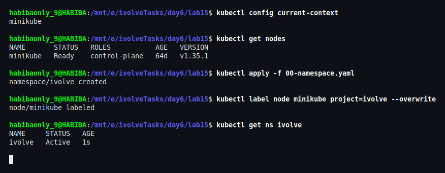
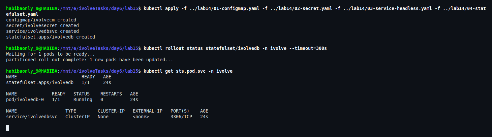
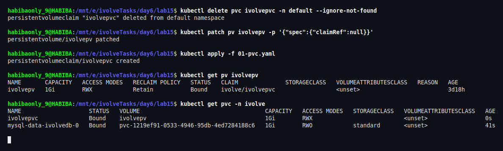
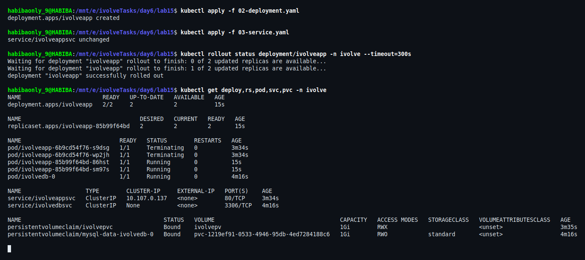
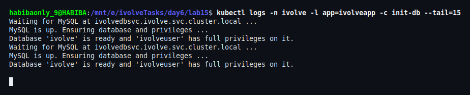
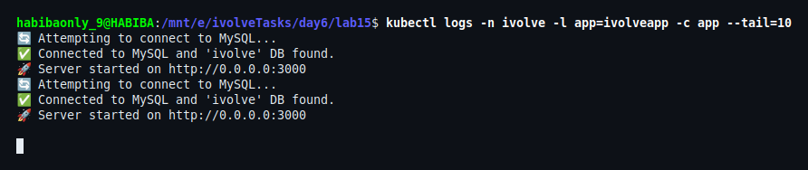
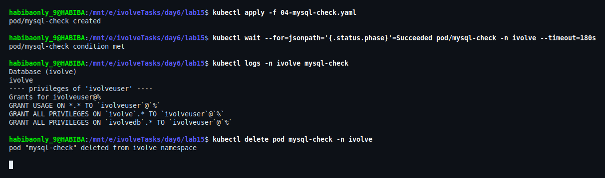
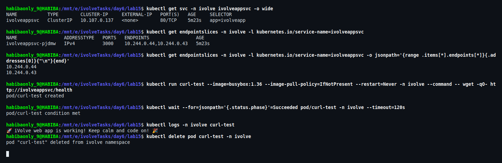
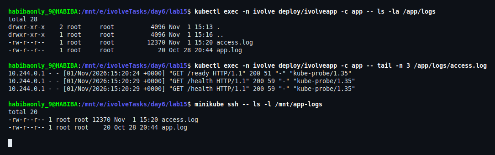
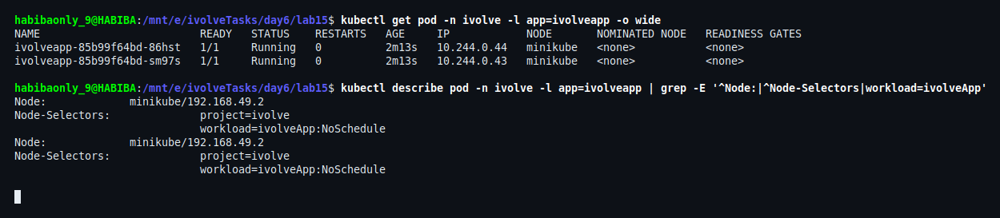

# Lab 15: Node.js Application Deployment with ClusterIP Service

## Overview

This lab deploys the **iVolve Node.js application** (the custom image built in Lab 8) on Kubernetes as a **Deployment** named `ivolveapp` in the `ivolve` namespace, with **2 replicas**, fronted by a **ClusterIP Service** named `ivolveappsvc`.

The application is stateless, so a Deployment is the right controller: Pods are interchangeable, the Service load-balances traffic across the available replicas, and a rolling update can replace them without downtime.

Three things make this lab more than a plain `kubectl create deployment`:

1. **Configuration is external** — the connection settings come from the ConfigMap `ivolvecm` and the Secret `ivolvesecret` created in Lab 14; nothing is hardcoded in the image.
2. **A MySQL backend is required** — the StatefulSet `ivolvedb` from Lab 14 (Headless Service `ivolvedbsvc`) is reused as the database.
3. **The database must exist before the app starts** — an **init container** waits for MySQL, creates the `ivolve` database and grants the application user its privileges, so the main container never races against an empty server.

The Pods also reuse the **PersistentVolume from Lab 13** (`ivolvepv`, `hostPath: /mnt/app-logs`) mounted at `/app/logs`, which is where the application writes its morgan access log. Persisting that path means the HTTP access history outlives the Pods.

## Objectives

1. Create a Deployment named `ivolveApp` in the `ivolve` namespace with 2 replicas.
2. Use the custom Docker image from Docker Hub that was built in Lab 8.
3. Configure the Pods to consume environment variables from the existing ConfigMap and Secret.
4. Add a node selector so Pods are scheduled only on nodes labelled `project=ivolve`.
5. Add a toleration with key `workload`, value `ivolveApp`, effect `NoSchedule`.
6. Configure the Pods to use the PersistentVolume created in Lab 13.
7. Add an init container using a MySQL client image to create the `ivolve` database and grant the application user the necessary privileges.
8. Pass the database connection parameters to the init container through environment variables from the ConfigMap and Secret.
9. Create a ClusterIP Service named `ivolveAppSvc` in the `ivolve` namespace to distribute traffic across the available application Pods.
10. Connect to MySQL manually to verify that the `ivolve` database was created and the application user has the required privileges.
11. Check the application logs to verify that the Node.js application connects to MySQL and accesses the `ivolve` database.

---

## Environment

| Component | Version |
|---|---|
| Docker | 29.8.0 |
| Minikube | v1.38.1 (docker driver) |
| Kubernetes | v1.35.1 |
| kubectl | v1.37.0 |
| Host | WSL2 Ubuntu 26.04 |
| Application image | `onlyhabiba/ivolve-app:latest` (built in Lab 8, present in the local Docker cache) |
| Database image | `mysql:8` |
| Namespace | `ivolve` |
| Node | `minikube` |

---

## Note on Naming

The lab sheet uses camelCase names (`ivolveApp`, `ivolveAppSvc`). Kubernetes **rejects** camelCase in `metadata.name`: object names must be lowercase DNS labels (RFC 1123).

```
metadata.name: Invalid value: "ivolveApp": a lowercase RFC 1123 subdomain must consist of lower case
alphanumeric characters, '-' or '.', and must start and end with an alphanumeric character
```

The manifests therefore use the lowercase equivalents:

| Lab requirement | Deployed name |
|---|---|
| Deployment `ivolveApp` | `ivolveapp` |
| ClusterIP Service `ivolveAppSvc` | `ivolveappsvc` |

The resulting in-cluster DNS name is:

- `ivolveappsvc.ivolve.svc.cluster.local` (port `80`)

---

## The Application and Its Backend

### The application (Lab 8 image)

`onlyhabiba/ivolve-app:latest` is the image pushed to Docker Hub in Lab 8. Its behaviour is what drives every design decision in this lab:

| Property | Value |
|---|---|
| Runtime | Node.js 18 (Express + mysql2 + morgan) |
| Listening port | `3000` |
| Environment variables | `DB_HOST`, `DB_USER`, `DB_PASSWORD` |
| Database name | hardcoded as `ivolve` |
| Log directory | `/app/logs/access.log` |
| Health endpoint | `GET /health` (checks the DB with `SELECT 1`) |
| Readiness endpoint | `GET /ready` |

Because the database name is hardcoded in the image, the ConfigMap needed one extra key — `DB_NAME: "ivolve"` — which was added in this lab. The init container, the deployment environment and the verification Pod all read that key instead of repeating the literal string.

### The backend (Lab 14)

The MySQL StatefulSet from Lab 14 is re-applied unchanged and used as the database server:

- Secret `ivolvesecret` → root and application passwords
- ConfigMap `ivolvecm` → `MYSQL_USER=ivolveuser`, `DB_HOST=ivolvedbsvc.ivolve.svc.cluster.local`, `DB_PORT=3306`, `DB_NAME=ivolve`
- Headless Service `ivolvedbsvc` → stable DNS name for `ivolvedb-0`

> The MySQL manifests are **not duplicated** in this folder. They are applied from `../lab14/` so the database definition lives in one place.
> The Secret is created locally from `lab14/02-secret.example.yaml` and is **git-ignored**; it is never committed or shown in a screenshot.

---

## File Structure

```
lab15/
├── 00-namespace.yaml    # Namespace: ivolve
├── 01-pvc.yaml          # PVC: ivolvepvc (bound to the Lab 13 PV ivolvepv)
├── 02-deployment.yaml   # Deployment: ivolveapp (2 replicas + init container + PVC mount)
├── 03-service.yaml      # Service: ivolveappsvc (ClusterIP, 80 → 3000)
├── 04-mysql-check.yaml  # One-shot verification Pod (databases + grants)
├── README.md
└── screenshots/         # Execution and verification evidence
```

---

## Manifest Definitions

### 1. Namespace (`00-namespace.yaml`)

```yaml
apiVersion: v1
kind: Namespace
metadata:
  name: ivolve
```

### 2. PersistentVolumeClaim (`01-pvc.yaml`)

The PersistentVolume `ivolvepv` was created in Lab 13 and is cluster-scoped, so it can be reused — but a PVC is namespaced, and a PV is bound to exactly one claim. The claim therefore has to live in `ivolve` (where the Pods are) and point at the existing volume explicitly:

```yaml
apiVersion: v1
kind: PersistentVolumeClaim
metadata:
  name: ivolvepvc
  namespace: ivolve
spec:
  storageClassName: ""
  volumeName: ivolvepv
  accessModes:
    - ReadWriteMany
  resources:
    requests:
      storage: 1Gi
```

`volumeName` pre-binds the claim to `ivolvepv`, and `storageClassName: ""` prevents the dynamic provisioner from creating a *new* volume instead. `ReadWriteMany` is used because both replicas mount the same log directory.

### 3. Deployment (`02-deployment.yaml`)

```yaml
apiVersion: apps/v1
kind: Deployment
metadata:
  name: ivolveapp
  namespace: ivolve
  labels:
    app: ivolveapp
spec:
  replicas: 2
  selector:
    matchLabels:
      app: ivolveapp
  strategy:
    type: RollingUpdate
    rollingUpdate:
      maxUnavailable: 0
      maxSurge: 1
  template:
    metadata:
      labels:
        app: ivolveapp
    spec:
      nodeSelector:
        project: ivolve
      tolerations:
        - key: workload
          operator: Equal
          value: ivolveApp
          effect: NoSchedule
      initContainers:
        - name: init-db
          image: mysql:8
          imagePullPolicy: IfNotPresent
          env:
            - name: DB_HOST
              valueFrom:
                configMapKeyRef:
                  name: ivolvecm
                  key: DB_HOST
            - name: DB_NAME
              valueFrom:
                configMapKeyRef:
                  name: ivolvecm
                  key: DB_NAME
            - name: DB_USER
              valueFrom:
                configMapKeyRef:
                  name: ivolvecm
                  key: MYSQL_USER
            - name: DB_PASSWORD
              valueFrom:
                secretKeyRef:
                  name: ivolvesecret
                  key: MYSQL_PASSWORD
            - name: MYSQL_ROOT_PASSWORD
              valueFrom:
                secretKeyRef:
                  name: ivolvesecret
                  key: MYSQL_ROOT_PASSWORD
          command:
            - bash
            - -c
            - |
              set -e
              echo "Waiting for MySQL at $DB_HOST ..."
              until MYSQL_PWD="$MYSQL_ROOT_PASSWORD" mysql -h "$DB_HOST" -u root -e "SELECT 1" >/dev/null 2>&1; do
                echo "MySQL not ready yet - retrying in 3s"
                sleep 3
              done
              echo "MySQL is up. Ensuring database and privileges ..."
              MYSQL_PWD="$MYSQL_ROOT_PASSWORD" mysql -h "$DB_HOST" -u root -e "
                CREATE DATABASE IF NOT EXISTS \`$DB_NAME\`;
                CREATE USER IF NOT EXISTS '$DB_USER'@'%' IDENTIFIED BY '$DB_PASSWORD';
                GRANT ALL PRIVILEGES ON \`$DB_NAME\`.* TO '$DB_USER'@'%';
                FLUSH PRIVILEGES;"
              echo "Database '$DB_NAME' is ready and '$DB_USER' has full privileges on it."
      containers:
        - name: app
          image: onlyhabiba/ivolve-app:latest
          imagePullPolicy: IfNotPresent
          ports:
            - name: http
              containerPort: 3000
          env:
            - name: DB_HOST
              valueFrom:
                configMapKeyRef:
                  name: ivolvecm
                  key: DB_HOST
            - name: DB_NAME
              valueFrom:
                configMapKeyRef:
                  name: ivolvecm
                  key: DB_NAME
            - name: DB_USER
              valueFrom:
                configMapKeyRef:
                  name: ivolvecm
                  key: MYSQL_USER
            - name: DB_PASSWORD
              valueFrom:
                secretKeyRef:
                  name: ivolvesecret
                  key: MYSQL_PASSWORD
          volumeMounts:
            - name: app-logs
              mountPath: /app/logs
          readinessProbe:
            httpGet:
              path: /ready
              port: 3000
            initialDelaySeconds: 10
            periodSeconds: 10
          livenessProbe:
            httpGet:
              path: /health
              port: 3000
            initialDelaySeconds: 30
            periodSeconds: 20
          resources:
            requests:
              cpu: "100m"
              memory: "128Mi"
      volumes:
        - name: app-logs
          persistentVolumeClaim:
            claimName: ivolvepvc
```

Key points:

- **`initContainers` runs to completion before the app starts**, so the `ivolve` schema and the grants exist by the time the Node.js process connects. It uses `CREATE ... IF NOT EXISTS` and `CREATE USER ... IF NOT EXISTS`, which makes it idempotent across Pod restarts.
- **The password is never passed on the command line.** `MYSQL_PWD` carries it into the `mysql` client, which avoids the `Using a password on the command line interface can be insecure` warning and keeps it out of screenshots and `ps` output.
- **`maxUnavailable: 0`** guarantees that during a rolling update both old Pods stay available until the new ones are ready.
- **`readinessProbe` hits `/ready`** (DB reachable), so a Pod with a broken DB connection is removed from the Service endpoints without being killed.

### 4. ClusterIP Service (`03-service.yaml`)

```yaml
apiVersion: v1
kind: Service
metadata:
  name: ivolveappsvc
  namespace: ivolve
  labels:
    app: ivolveapp
spec:
  type: ClusterIP
  selector:
    app: ivolveapp
  ports:
    - name: http
      port: 80
      targetPort: 3000
      protocol: TCP
```

`type: ClusterIP` is the default: a virtual IP that is reachable from inside the cluster only. The selector `app=ivolveapp` matches both replicas, so kube-proxy load-balances each connection across them. Port `80` is exposed for a clean service name while the container keeps listening on `3000`.

### 5. Verification Pod (`04-mysql-check.yaml`)

A one-shot MySQL client Pod used to prove the database exists and the application user has the right grants. It reads the password from the Secret into `MYSQL_PWD` instead of typing it:

```yaml
apiVersion: v1
kind: Pod
metadata:
  name: mysql-check
  namespace: ivolve
  labels:
    purpose: verification
spec:
  restartPolicy: Never
  nodeSelector:
    project: ivolve
  tolerations:
    - key: workload
      operator: Equal
      value: ivolveApp
      effect: NoSchedule
  containers:
    - name: mysql-client
      image: mysql:8
      imagePullPolicy: IfNotPresent
      env:
        - name: MYSQL_PWD
          valueFrom:
            secretKeyRef:
              name: ivolvesecret
              key: MYSQL_ROOT_PASSWORD
        - name: DB_NAME
          valueFrom:
            configMapKeyRef:
              name: ivolvecm
              key: DB_NAME
        - name: DB_USER
          valueFrom:
            configMapKeyRef:
              name: ivolvecm
              key: MYSQL_USER
      command:
        - bash
        - -c
        - |
          mysql -h ivolvedbsvc -u root -e "SHOW DATABASES LIKE '$DB_NAME';"
          echo "---- privileges of '$DB_USER' ----"
          mysql -h ivolvedbsvc -u root -e "SHOW GRANTS FOR '$DB_USER'@'%';"
```

---

## Steps and Verification

### Step 0: Prepare the Image Offline

The image was **already present** in the local Docker cache, so it was loaded into the Minikube node without pulling anything from the registry:

```bash
docker images | grep ivolve-app
docker save onlyhabiba/ivolve-app:latest -o ivolve-app.tar
minikube image load ivolve-app.tar
```

### Step 1: Create the Namespace and Label the Node

```bash
kubectl config current-context
kubectl get nodes
kubectl apply -f 00-namespace.yaml
kubectl label node minikube project=ivolve --overwrite
kubectl get ns ivolve
```

The context is `minikube`, the node is `Ready`, the namespace is `Active`, and the node carries `project=ivolve` — the label required by the `nodeSelector`.



### Step 2: Bring Up the MySQL Backend (from Lab 14)

The Deployment is useless without a database, so the Lab 14 objects are applied first:

```bash
kubectl apply -f ../lab14/01-configmap.yaml \
              -f ../lab14/02-secret.yaml \
              -f ../lab14/03-service-headless.yaml \
              -f ../lab14/04-statefulset.yaml

kubectl rollout status statefulset/ivolvedb -n ivolve --timeout=300s
kubectl get sts,pod,svc -n ivolve
```

`ivolvedb-0` reaches `1/1 Running` and the Headless Service `ivolvedbsvc` is created with `CLUSTER-IP None`.



### Step 3: Reuse the Lab 13 PersistentVolume

The PV from Lab 13 was still bound to a claim in the `default` namespace. A PV can only serve one claim, so the claim is moved to the `ivolve` namespace:

```bash
kubectl delete pvc ivolvepvc -n default --ignore-not-found
kubectl patch pv ivolvepv -p '{"spec":{"claimRef":null}}'
kubectl apply -f 01-pvc.yaml
kubectl get pv ivolvepv
kubectl get pvc -n ivolve
```

Clearing `claimRef` releases the volume without deleting it, and the new claim pre-binds to it with `volumeName: ivolvepv`. The result is `ivolvepv → ivolve/ivolvepvc`, `1Gi`, `RWX`, `Retain`.



### Step 4: Create the Deployment and the ClusterIP Service

```bash
kubectl apply -f 02-deployment.yaml
kubectl apply -f 03-service.yaml
kubectl rollout status deployment/ivolveapp -n ivolve --timeout=300s
kubectl get deploy,rs,pod,svc,pvc -n ivolve
```

Two application Pods reach `1/1 Running`, the ReplicaSet is `2/2`, and the Service `ivolveappsvc` is created as `ClusterIP` on port `80/TCP`.



### Step 5: Verify the Init Container Created the Database

```bash
kubectl logs -n ivolve -l app=ivolveapp -c init-db --tail=15
```

Each Pod's init container waits for MySQL, creates the `ivolve` database, creates `ivolveuser`, grants it full privileges on `ivolve.*` and exits successfully — which is what allows the main container to start. No password appears in the output.



### Step 6: Verify the Application Connects to MySQL

```bash
kubectl logs -n ivolve -l app=ivolveapp -c app --tail=10
```

The Node.js process logs `🔄 Attempting to connect to MySQL...`, then `✅ Connected to MySQL and 'ivolve' DB found.` and `🚀 Server started on http://0.0.0.0:3000` — proof that the ConfigMap/Secret values are correct and that the database created by the init container is the one the app uses.



### Step 7: Verify the Database and the Application User's Privileges

```bash
kubectl apply -f 04-mysql-check.yaml
kubectl wait --for=jsonpath='{.status.phase}'=Succeeded pod/mysql-check -n ivolve --timeout=180s
kubectl logs -n ivolve mysql-check
kubectl delete pod mysql-check -n ivolve
```

`SHOW DATABASES LIKE 'ivolve'` returns `ivolve`, and `SHOW GRANTS FOR 'ivolveuser'@'%'` shows `GRANT ALL PRIVILEGES ON \`ivolve\`.*` (plus the privileges Lab 14 granted on `ivolvedb`). The password is supplied through `MYSQL_PWD`, so it never appears on the command line or in the log.



### Step 8: Verify the ClusterIP Service Distributes Traffic

```bash
kubectl get svc -n ivolve ivolveappsvc -o wide
kubectl get endpointslices -n ivolve -l kubernetes.io/service-name=ivolveappsvc
kubectl run curl-test --image=busybox:1.36 --image-pull-policy=IfNotPresent \
  --restart=Never -n ivolve --command -- wget -qO- http://ivolveappsvc/health
kubectl wait --for=jsonpath='{.status.phase}'=Succeeded pod/curl-test -n ivolve --timeout=120s
kubectl logs -n ivolve curl-test
kubectl delete pod curl-test -n ivolve
```

The Service has the cluster IP `10.107.0.137` on port `80`, its EndpointSlice lists **both** Pod IPs (`10.244.0.44`, `10.244.0.43`), and a Pod calling `http://ivolveappsvc/health` (no port, no Pod IP) receives the application's success message — the Service name is enough to reach a replica.



### Step 9: Verify the Persistent Logs Volume

```bash
kubectl exec -n ivolve deploy/ivolveapp -c app -- ls -la /app/logs
kubectl exec -n ivolve deploy/ivolveapp -c app -- tail -n 3 /app/logs/access.log
minikube ssh -- ls -l /mnt/app-logs
```

`/app/logs` inside the container and `/mnt/app-logs` on the node show the same files (`access.log`, `app.log`), and the access log contains real requests — including the probes and the `wget` from Step 8. The log therefore lives on the PersistentVolume, not in the container filesystem.



### Step 10: Prove the Scheduling Rules

```bash
kubectl get pod -n ivolve -l app=ivolveapp -o wide
kubectl describe pod -n ivolve -l app=ivolveapp | grep -E '^Node:|^Node-Selectors|workload=ivolveApp'
```

Both Pods run on node `minikube`, show `Node-Selectors: project=ivolve`, and carry the toleration `workload=ivolveApp:NoSchedule`.



---

## Verification Summary

| Requirement | Verified evidence |
|---|---|
| Deployment `ivolveapp`, 2 replicas | Step 4 — `2/2` ready, ReplicaSet `2/2` |
| Custom Docker Hub image from Lab 8 | `onlyhabiba/ivolve-app:latest`, loaded offline into the node |
| Env from ConfigMap and Secret | Steps 6 and 7 — app connects, init container logs the DB name |
| `nodeSelector: project=ivolve` | Steps 1 and 10 |
| Toleration `workload=ivolveApp:NoSchedule` | Step 10 |
| Lab 13 PersistentVolume in use | Steps 3 and 9 — `/app/logs` = `/mnt/app-logs` |
| Init container creates `ivolve` + grants | Step 5 — init logs |
| Init container env from ConfigMap/Secret | Step 5 and the Deployment manifest |
| ClusterIP Service `ivolveappsvc` | Steps 4 and 8 — `10.107.0.137:80 → 3000` |
| Manual MySQL check of DB and privileges | Step 7 — `SHOW DATABASES`, `SHOW GRANTS` |
| Application logs show a successful DB connection | Step 6 |

---

## Security Note

- Every credential used here is a **lab-only dummy value** on a local Minikube cluster.
- The real Secret manifest (`lab14/02-secret.yaml`) is **git-ignored**; only `lab14/02-secret.example.yaml` is published.
- Passwords reach the containers through `valueFrom.secretKeyRef` — they are never written in the Deployment, the ConfigMap, a `kubectl run` command line, or a screenshot.
- The `mysql` client reads the password from `MYSQL_PWD`, which keeps it out of the process list (`ps`) and out of the `Using a password on the command line` warning.
- Base64 is encoding, **not encryption**; Secrets are protected by RBAC and etcd encryption, not by base64.
- Screenshots in this lab were reviewed before being published: none of them shows a credential value.

---

## Cleanup

```bash
kubectl delete -f 04-mysql-check.yaml --ignore-not-found
kubectl delete -f 03-service.yaml -f 02-deployment.yaml
kubectl delete -f 01-pvc.yaml

# the Lab 14 backend
kubectl delete -f ../lab14/04-statefulset.yaml
kubectl delete -f ../lab14/03-service-headless.yaml
kubectl delete pvc -n ivolve --all

kubectl delete namespace ivolve
kubectl label node minikube project-
```

> Deleting the namespace removes everything inside it. The PersistentVolume `ivolvepv` is **not** deleted because its reclaim policy is `Retain` — it stays available for the next lab and has to be released (`kubectl patch pv ivolvepv -p '{"spec":{"claimRef":null}}'`) before it can be claimed again.

## Conclusion

The Node.js application was deployed as a 2-replica Deployment whose configuration comes entirely from a ConfigMap and a Secret, scheduled onto the labelled node and protected by the required toleration. An init container made startup order explicit and idempotent: it waited for MySQL, created the `ivolve` database and granted the application user its privileges, all from environment variables, without exposing a password. The ClusterIP Service load-balanced traffic across both replicas, and the application logs proved a live connection to MySQL. Finally, the logs written to `/app/logs` were shown to land on the Lab 13 PersistentVolume, so the access history survives Pod recreation.
