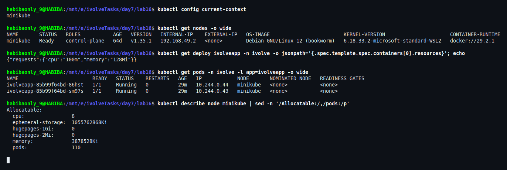
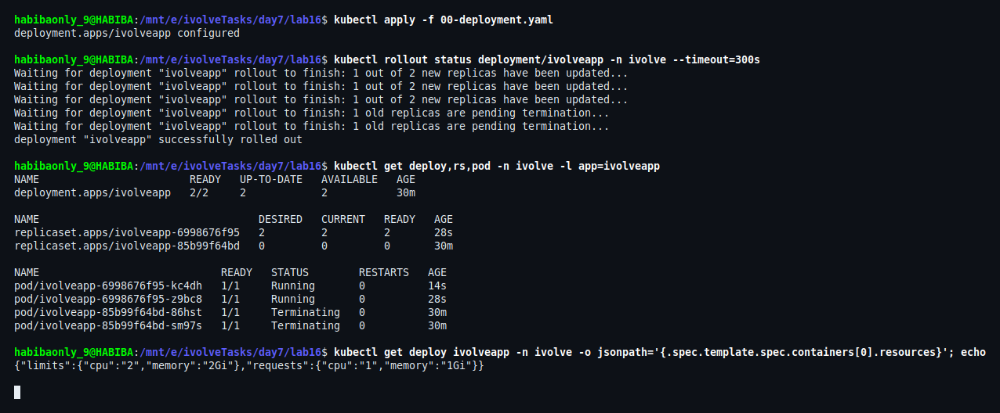
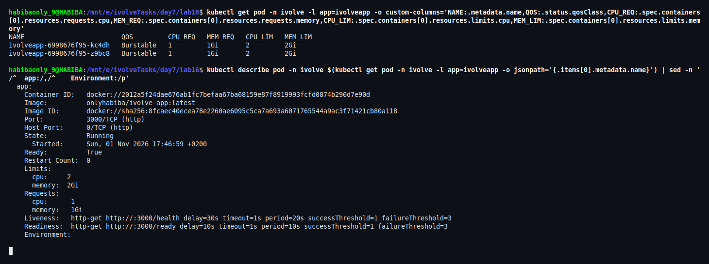
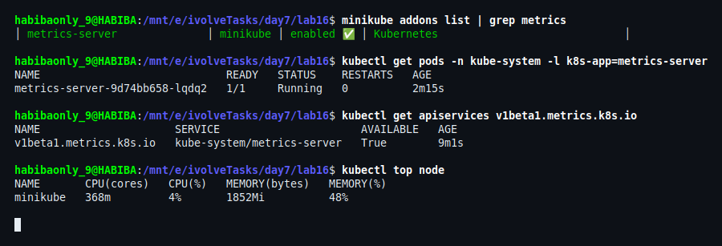
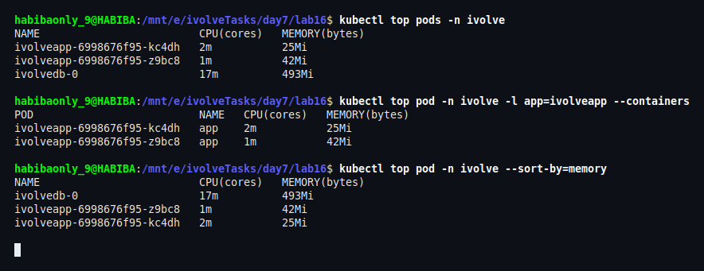
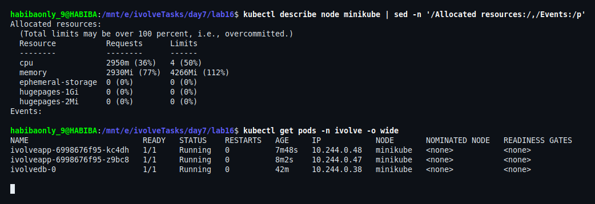

# Lab 16: Pod Resource Management with CPU and Memory Requests and Limits

## Overview

This lab updates the existing `ivolveapp` Deployment (Lab 15) so that each Pod declares **explicit CPU and memory requests and limits**:

| Container | CPU request | Memory request | CPU limit | Memory limit |
|---|---|---|---|---|
| `app` | `1` (1 vCPU) | `1Gi` | `2` (2 vCPU) | `2Gi` |

Requests and limits answer two different questions, and Kubernetes handles them with two different components:

- **Requests** are used by the **scheduler**. A Pod is only placed on a node that has at least that much *unreserved* CPU and memory. The request is also what the node reserves for the Pod when it is under pressure.
- **Limits** are enforced by the **container runtime** (cgroups). A container that tries to exceed its memory limit is **OOM-killed**; a container that tries to exceed its CPU limit is **throttled** (it keeps running, just slower).

The result of setting both — with different values — is a Pod with the **Burstable** QoS class: it has a guaranteed floor (the request) and a hard ceiling (the limit).

## Objectives

1. Update the existing `ivolveApp` Deployment to include resource requests and limits.
2. Requests: `cpu: 1`, `memory: 1Gi`.
3. Limits: `cpu: 2`, `memory: 2Gi`.
4. Use `kubectl describe pod` to verify the applied requests and limits.
5. Use `kubectl top pod` to monitor real-time resource usage (the metrics server must be running in the cluster).

---

## Environment

| Component | Version |
|---|---|
| Docker | 29.8.0 |
| Minikube | v1.38.1 (docker driver) |
| Kubernetes | v1.35.1 |
| kubectl | v1.37.0 |
| Host | WSL2 Ubuntu 26.04 |
| Application image | `onlyhabiba/ivolve-app:latest` |
| Namespace | `ivolve` |
| Node | `minikube` — allocatable: **8 CPU**, **3878528Ki (~3.7Gi) memory** |
| Metrics | `metrics-server` addon, image `registry.k8s.io/metrics-server/metrics-server:v0.8.1` |

---

## What Changed Compared to Lab 15

Only the `resources` block of the `app` container changed:

```diff
-          resources:
-            requests:
-              cpu: "100m"
-              memory: "128Mi"
+          resources:
+            requests:
+              cpu: "1"
+              memory: "1Gi"
+            limits:
+              cpu: "2"
+              memory: "2Gi"
```

Everything else — replicas, image, env from the ConfigMap/Secret, the `init-db` init container, the PVC at `/app/logs`, the `nodeSelector`, the toleration, the probes — is unchanged from Lab 15, so this lab is a pure scheduling/resource change.

> `lab15/02-deployment.yaml` keeps the manifest as it was submitted for Lab 15. The updated manifest is `lab16/00-deployment.yaml` and supersedes it.

The same change can be applied imperatively, which is useful to know for a running cluster:

```bash
kubectl set resources deployment/ivolveapp -n ivolve \
  --requests=cpu=1,memory=1Gi \
  --limits=cpu=2,memory=2Gi
```

This lab uses the declarative manifest (`kubectl apply`), because the repository is the source of truth.

---

## File Structure

```
lab16/
├── 00-deployment.yaml   # Deployment: ivolveapp with requests (1 / 1Gi) and limits (2 / 2Gi)
├── README.md
└── screenshots/         # Execution and verification evidence
```

---

## Manifest

### `00-deployment.yaml`

```yaml
apiVersion: apps/v1
kind: Deployment
metadata:
  name: ivolveapp
  namespace: ivolve
  labels:
    app: ivolveapp
spec:
  replicas: 2
  selector:
    matchLabels:
      app: ivolveapp
  strategy:
    type: RollingUpdate
    rollingUpdate:
      maxUnavailable: 0
      maxSurge: 1
  template:
    metadata:
      labels:
        app: ivolveapp
    spec:
      nodeSelector:
        project: ivolve
      tolerations:
        - key: workload
          operator: Equal
          value: ivolveApp
          effect: NoSchedule
      initContainers:
        - name: init-db
          image: mysql:8
          imagePullPolicy: IfNotPresent
          env:
            - name: DB_HOST
              valueFrom:
                configMapKeyRef:
                  name: ivolvecm
                  key: DB_HOST
            - name: DB_NAME
              valueFrom:
                configMapKeyRef:
                  name: ivolvecm
                  key: DB_NAME
            - name: DB_USER
              valueFrom:
                configMapKeyRef:
                  name: ivolvecm
                  key: MYSQL_USER
            - name: DB_PASSWORD
              valueFrom:
                secretKeyRef:
                  name: ivolvesecret
                  key: MYSQL_PASSWORD
            - name: MYSQL_ROOT_PASSWORD
              valueFrom:
                secretKeyRef:
                  name: ivolvesecret
                  key: MYSQL_ROOT_PASSWORD
          command:
            - bash
            - -c
            - |
              set -e
              echo "Waiting for MySQL at $DB_HOST ..."
              until MYSQL_PWD="$MYSQL_ROOT_PASSWORD" mysql -h "$DB_HOST" -u root -e "SELECT 1" >/dev/null 2>&1; do
                echo "MySQL not ready yet - retrying in 3s"
                sleep 3
              done
              echo "MySQL is up. Ensuring database and privileges ..."
              MYSQL_PWD="$MYSQL_ROOT_PASSWORD" mysql -h "$DB_HOST" -u root -e "
                CREATE DATABASE IF NOT EXISTS \`$DB_NAME\`;
                CREATE USER IF NOT EXISTS '$DB_USER'@'%' IDENTIFIED BY '$DB_PASSWORD';
                GRANT ALL PRIVILEGES ON \`$DB_NAME\`.* TO '$DB_USER'@'%';
                FLUSH PRIVILEGES;"
              echo "Database '$DB_NAME' is ready and '$DB_USER' has full privileges on it."
      containers:
        - name: app
          image: onlyhabiba/ivolve-app:latest
          imagePullPolicy: IfNotPresent
          ports:
            - name: http
              containerPort: 3000
          env:
            - name: DB_HOST
              valueFrom:
                configMapKeyRef:
                  name: ivolvecm
                  key: DB_HOST
            - name: DB_NAME
              valueFrom:
                configMapKeyRef:
                  name: ivolvecm
                  key: DB_NAME
            - name: DB_USER
              valueFrom:
                configMapKeyRef:
                  name: ivolvecm
                  key: MYSQL_USER
            - name: DB_PASSWORD
              valueFrom:
                secretKeyRef:
                  name: ivolvesecret
                  key: MYSQL_PASSWORD
          volumeMounts:
            - name: app-logs
              mountPath: /app/logs
          readinessProbe:
            httpGet:
              path: /ready
              port: 3000
            initialDelaySeconds: 10
            periodSeconds: 10
          livenessProbe:
            httpGet:
              path: /health
              port: 3000
            initialDelaySeconds: 30
            periodSeconds: 20
          # Lab 16: guaranteed reservation (requests) + hard ceiling (limits)
          resources:
            requests:
              cpu: "1"
              memory: "1Gi"
            limits:
              cpu: "2"
              memory: "2Gi"
      volumes:
        - name: app-logs
          persistentVolumeClaim:
            claimName: ivolvepvc
```

### Why these numbers work on this node

| Resource | Per Pod | 2 Pods | Node allocatable | Fit? |
|---|---|---|---|---|
| CPU request | `1` | `2` | `8` | ✅ |
| Memory request | `1Gi` | `2Gi` | `~3.7Gi` | ✅ (with the rest of the workloads) |
| CPU limit | `2` | `4` | `8` | ✅ |
| Memory limit | `2Gi` | `4Gi` | `~3.7Gi` | ⚠️ overcommitted on purpose — limits are ceilings, not reservations |

Overcommitting **limits** is normal and intended: the scheduler only reserves the **requests**, and the kernel only prevents a container from *crossing* its own limit. What must never overcommit is the **requests** — otherwise Pods would be scheduled onto a node that cannot actually hold them.

---

## Steps and Verification

### Step 1: Capture the Baseline

```bash
kubectl config current-context
kubectl get nodes -o wide
kubectl get deploy ivolveapp -n ivolve -o jsonpath='{.spec.template.spec.containers[0].resources}'; echo
kubectl get pods -n ivolve -l app=ivolveapp -o wide
kubectl describe node minikube | sed -n '/Allocatable:/,/pods:/p'
```

The Deployment from Lab 15 only asked for `{"requests":{"cpu":"100m","memory":"128Mi"}}` — no limits at all — and both replicas were `Running`. The node offers 8 CPUs and ~3.7Gi of allocatable memory.



### Step 2: Apply the Updated Deployment

```bash
kubectl apply -f 00-deployment.yaml
kubectl rollout status deployment/ivolveapp -n ivolve --timeout=300s
kubectl get deploy,rs,pod -n ivolve -l app=ivolveapp
kubectl get deploy ivolveapp -n ivolve -o jsonpath='{.spec.template.spec.containers[0].resources}'; echo
```

`kubectl apply` reports `deployment.apps/ivolveapp configured`, a **new ReplicaSet** is created, and — because the strategy is `maxUnavailable: 0` — the old Pods stay up until the new ones are ready. The rollout finishes with `2/2` available, and the live spec now returns:

```json
{"limits":{"cpu":"2","memory":"2Gi"},"requests":{"cpu":"1","memory":"1Gi"}}
```



### Step 3: Verify with `kubectl describe pod`

```bash
kubectl get pod -n ivolve -l app=ivolveapp -o custom-columns='NAME:.metadata.name,QOS:.status.qosClass,CPU_REQ:.spec.containers[0].resources.requests.cpu,MEM_REQ:.spec.containers[0].resources.requests.memory,CPU_LIM:.spec.containers[0].resources.limits.cpu,MEM_LIM:.spec.containers[0].resources.limits.memory'

kubectl describe pod -n ivolve \
  $(kubectl get pod -n ivolve -l app=ivolveapp -o jsonpath='{.items[0].metadata.name}') \
  | sed -n '/^  app:/,/^    Environment:/p'
```

Both Pods report the same values, and `describe` shows the container-level block exactly as declared:

```
    Limits:
      cpu:     2
      memory:  2Gi
    Requests:
      cpu:      1
      memory:   1Gi
```

The QoS class is `Burstable`, which is the expected class when requests are lower than limits. (A Pod with `requests == limits` would be `Guaranteed`; a Pod with no requests and no limits at all would be `BestEffort` — which is what the Lab 15 manifest effectively was for memory/CPU.)



### Step 4: Start the Metrics Server

`kubectl top` reads from the `metrics.k8s.io` API, which is served by **metrics-server**, and that addon is **disabled by default** on Minikube:

```bash
minikube addons list | grep metrics
minikube addons enable metrics-server
kubectl get pods -n kube-system -l k8s-app=metrics-server
kubectl get apiservices v1beta1.metrics.k8s.io
kubectl top node
```

The addon deploys `registry.k8s.io/metrics-server/metrics-server:v0.8.1`. Its image was **not** present in the local cache, and the kubelet's own pull from `registry.k8s.io` timed out (the registry is slow from this network), so the image was pulled once with Docker Desktop and loaded into the node — no repeated pulls:

```bash
docker pull registry.k8s.io/metrics-server/metrics-server:v0.8.1
docker save registry.k8s.io/metrics-server/metrics-server:v0.8.1 -o ms.tar
minikube image load ms.tar
```

Once the Pod is `1/1 Running`, the APIService becomes `AVAILABLE True` and `kubectl top node` returns live numbers. The first scrape takes about a minute; before that the server logs `no metrics to serve`.



### Step 5: Monitor Real-Time Usage with `kubectl top pod`

```bash
kubectl top pods -n ivolve
kubectl top pod -n ivolve -l app=ivolveapp --containers
kubectl top pod -n ivolve --sort-by=memory
```

The values are **usage**, not requests: the application Pods sit at roughly `1–2m` CPU and `25–42Mi` memory, because an idle Express server does almost nothing. The database Pod is the heavy one at ~`17m` CPU and ~`493Mi` memory.

That gap is exactly the point of requests: the workload requested `1` CPU and `1Gi` **to guarantee headroom** for traffic spikes, not because it uses them while idle.



### Step 6: Review the Node Allocation After the Change

```bash
kubectl describe node minikube | sed -n '/Allocated resources:/,/Events:/p'
kubectl get pods -n ivolve -o wide
```

Before the change the node had `1050m` CPU and `938Mi` memory reserved. After it, the scheduler accounts for the new requests:

```
Resource           Requests     Limits
--------           --------     ------
cpu                2950m (36%)  4 (50%)
memory             2930Mi (77%) 4266Mi (112%)
```

- **Requests** stayed comfortably below the node capacity (`36%` CPU, `77%` memory), so both replicas are schedulable and safe.
- **Memory limits** exceed 100% (`112%`) — the node is *overcommitted on limits*, which is allowed and expected: limits are enforced per container by cgroups, not reserved by the scheduler.
- Both application Pods remain `1/1 Running` on `minikube`.



---

## Verification Summary

| Requirement | Verified evidence |
|---|---|
| Deployment updated with resources | Step 2 — `configured`, new ReplicaSet, rollout `2/2` |
| Request `cpu: 1` | Steps 2 and 3 — `requests.cpu: 1`, `cpu: 1` in `describe` |
| Request `memory: 1Gi` | Steps 2 and 3 — `requests.memory: 1Gi` |
| Limit `cpu: 2` | Steps 2 and 3 — `limits.cpu: 2` |
| Limit `memory: 2Gi` | Steps 2 and 3 — `limits.memory: 2Gi` |
| `kubectl describe pod` verification | Step 3 — Limits/Requests block, QoS `Burstable` |
| metrics-server running | Step 4 — addon enabled, Pod `1/1 Running`, APIService `True` |
| `kubectl top pod` monitoring | Step 5 — per-Pod and per-container usage |
| Node-level accounting | Step 6 — `Allocated resources` before/after |

---

## Notes on Resource Management

- **Requests drive scheduling; limits drive enforcement.** A Pod whose request is larger than the free capacity of every node stays `Pending` with `0/1 nodes are available: insufficient cpu`.
- **Memory limits are hard**: crossing `2Gi` kills the container with `OOMKilled` (visible in `kubectl describe pod` as `Last State: Terminated, Reason: OOMKilled`).
- **CPU limits are soft in effect**: the container is throttled rather than killed, which shows up as a rising `container_cpu_cfs_throttled_seconds_total` in cAdvisor metrics.
- **`requests == limits`** gives the `Guaranteed` QoS class — the safest option for latency-critical workloads, but it removes all burst room.
- **No limits at all** gives `BestEffort`/`Burstable` with no ceiling: one runaway Pod can starve every other Pod on the node.
- `kubectl top` shows a point-in-time sample from metrics-server (default resolution `60s` here), so short spikes can be missed — for history, a monitoring stack is needed.

---

## Security Note

- No credential is written into this manifest: the database user and password still come from the ConfigMap `ivolvecm` and the Secret `ivolvesecret` through `valueFrom`/`secretKeyRef`.
- The only new data in this lab is resource arithmetic (`cpu`/`memory`), so none of the screenshots can expose a password.
- As in the previous labs, the Secret is git-ignored and only its template is published.

---

## Cleanup

Revert the Deployment to the Lab 15 resources, or remove it entirely:

```bash
# option 1 — go back to the Lab 15 values
kubectl set resources deployment/ivolveapp -n ivolve \
  --requests=cpu=100m,memory=128Mi \
  --limits=cpu=0,memory=0

# option 2 — remove the deployment and its service
kubectl delete -f 00-deployment.yaml
kubectl delete svc ivolveappsvc -n ivolve

# optional — stop the metrics server again
minikube addons disable metrics-server
```

> `--limits=cpu=0,memory=0` removes the limits (it is the documented way to clear them with `kubectl set resources`).
> Disabling the addon keeps the downloaded image in the node cache, so re-enabling it later does not pull again.

## Conclusion

Setting requests to `1` CPU / `1Gi` and limits to `2` CPU / `2Gi` gave the application Pods a guaranteed reservation for the scheduler and a hard ceiling for the runtime, moving them to the `Burstable` QoS class. A rolling update replaced both replicas without downtime, `kubectl describe pod` confirmed the exact values, and — after enabling the `metrics-server` addon — `kubectl top node` / `kubectl top pod` showed that real usage (a few millicores and tens of mebibytes) sits far below the reservation. The node view made the difference explicit: requests stayed at 36% of CPU and 77% of memory, while limits were overcommitted on purpose.
