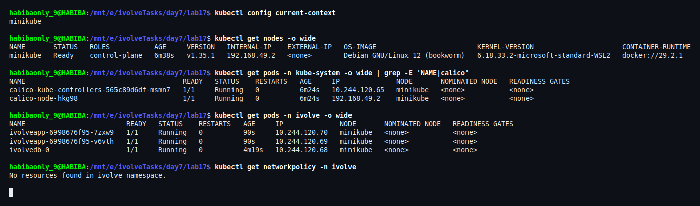
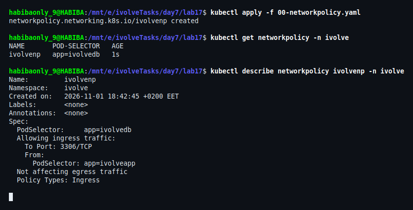
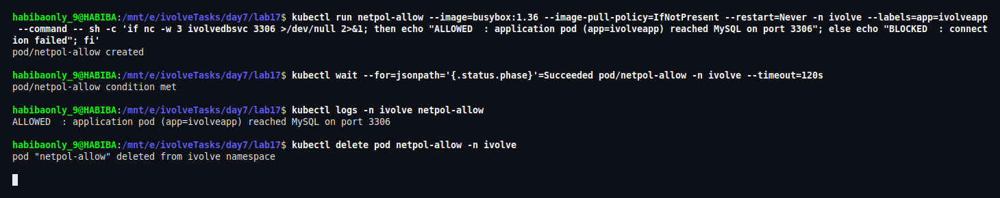
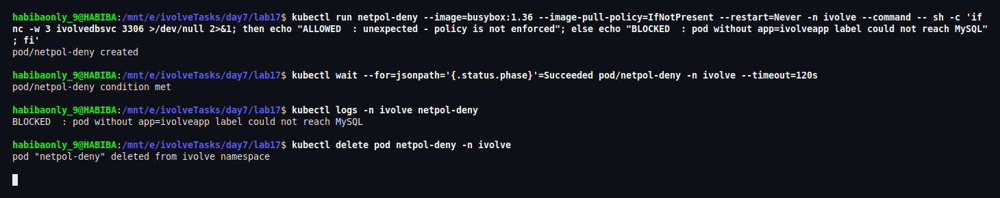
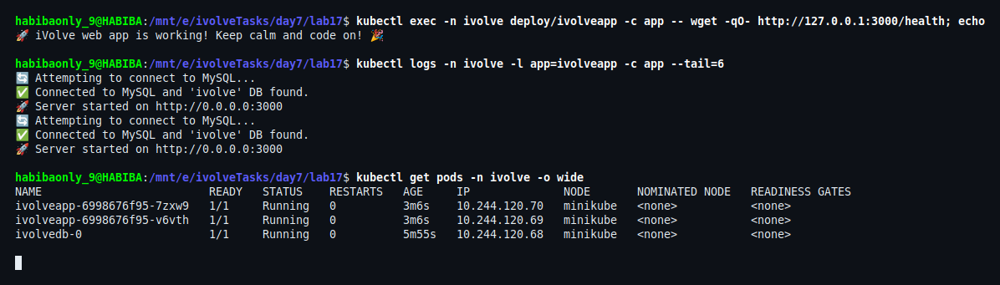
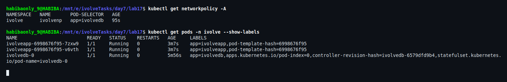

# Lab 17: Control Pod-to-Pod Traffic with NetworkPolicy

## Overview

This lab restricts who is allowed to open a connection to the MySQL Pod from Lab 14. A `NetworkPolicy` named `ivolvenp` is applied to the database Pod: the only permitted ingress is **TCP port 3306** from Pods labelled **`app=ivolveapp`** — the application Pods from Lab 15.

The result is a typical micro-segmentation rule: the database stops accepting connections from every Pod in the namespace and accepts them only from its own client workload, on its own port.

## Objectives

1. Define a NetworkPolicy named `ivolveNP`.
2. Pod selector: target the MySQL Pod.
3. Policy types: `Ingress` only.
4. Ingress rule: allow traffic only from the application Pods.
5. Restrict access to port `3306` (the MySQL default port).

---

## Environment

| Component | Version |
|---|---|
| Minikube | v1.38.1 (docker driver) |
| Kubernetes | v1.35.1 |
| kubectl | v1.37.0 |
| Host | WSL2 Ubuntu 26.04 |
| CNI | **Calico v3.31.3** (`calico-node`, `calico-kube-controllers`) |
| Namespace | `ivolve` |
| Application | `ivolveapp` Deployment, 2 replicas (Labs 15–16) |
| Database | `ivolvedb-0` StatefulSet, MySQL 8 (Lab 14) |

---

## Why the CNI Had to Change

Kubernetes only **stores** a NetworkPolicy and hands it to the network plugin. It does not filter packets itself. Enforcement is the job of the **CNI plugin**, and the default plugin in Minikube (`bridge`) does not implement NetworkPolicy at all.

The cluster this lab started from was using that default. On the node:

```bash
minikube ssh -- cat /etc/cni/net.d/1-k8s.conflist
```

```json
{
  "cniVersion": "0.4.0",
  "name": "bridge",
  "plugins": [
    { "type": "bridge", "bridge": "bridge", "ipam": { "subnet": "10.244.0.0/16" } },
    { "type": "portmap" },
    { "type": "firewall" }
  ]
}
```

With this plugin a NetworkPolicy is accepted by the API server, appears in `kubectl get networkpolicy`, and blocks nothing — there is no component that translates the rule into iptables/nftables entries.

Two practical consequences:

- **The CNI is chosen at node creation time.** Running `minikube start --cni=calico` against an existing node only records the new value in the profile; the node keeps its old CNI configuration and no Calico Pods are created. That is why the cluster was recreated with `--cni=calico` before applying the policy.
- **Calico needs to be present before the workloads start**, otherwise the existing Pods would keep their bridge networking and never be registered as Calico endpoints.

Calico implements the policy with iptables rules programmed by `calico-node` (Felix), so the rule is enforced by the kernel on the node.

---

## Note on Naming

The lab sheet names the policy `ivolveNP`; Kubernetes rejects camelCase in `metadata.name`:

```
metadata.name: Invalid value: "ivolveNP": a lowercase RFC 1123 subdomain must consist of lower case
alphanumeric characters, '-' or '.', and must start and end with an alphanumeric character
```

The manifest therefore uses `ivolvenp`, matching the lowercase convention already used for `ivolvedb`, `ivolveapp` and `ivolveappsvc`.

---

## File Structure

```
lab17/
├── 00-networkpolicy.yaml   # NetworkPolicy: ivolvenp (Ingress, from app=ivolveapp, port 3306)
├── README.md
└── screenshots/            # Execution and verification evidence
```

---

## Manifest

```yaml
apiVersion: networking.k8s.io/v1
kind: NetworkPolicy
metadata:
  name: ivolvenp
  namespace: ivolve
spec:
  # The Pods this policy protects: the MySQL Pods (label app=ivolvedb)
  podSelector:
    matchLabels:
      app: ivolvedb
  policyTypes:
    - Ingress
  ingress:
    # Allowed sources: Pods carrying app=ivolveapp
    - from:
        - podSelector:
            matchLabels:
              app: ivolveapp
      # ... and only the MySQL port
      ports:
        - protocol: TCP
          port: 3306
```

Field by field:

| Field | Meaning here |
|---|---|
| `spec.podSelector` | Selects `app=ivolvedb`, i.e. the `ivolvedb-0` Pod. Only selected Pods are affected. |
| `spec.policyTypes: [Ingress]` | Ingress is enforced and **egress is left untouched** — MySQL can still reach DNS and other services. |
| `spec.ingress[0].from.podSelector` | Source selector, evaluated **inside the same namespace** (`ivolve`). Only Pods with `app=ivolveapp` match. |
| `spec.ingress[0].ports` | Restricts the allowed traffic to TCP `3306`. A connection to any other port on the database Pod is dropped. |

Notes on semantics:

- Selecting a Pod with a policy makes it **default-deny for ingress**; the `from` entries are the only exceptions. Traffic from every other Pod in the namespace is now dropped.
- The `podSelector`/`namespaceSelector` in `from` match **labels**, not names. Any Pod created with `app=ivolveapp` is allowed; renaming the Deployment without updating the label would silently break the database access.
- Policies are **additive**: if another policy also allowed a source, both would apply. There is no "deny" rule type to override.

---

## Steps and Verification

### Step 1: Confirm the CNI Enforces NetworkPolicy

```bash
kubectl config current-context
kubectl get nodes -o wide
kubectl get pods -n kube-system -o wide | grep -E 'NAME|calico'
kubectl get pods -n ivolve -o wide
kubectl get networkpolicy -n ivolve
```

`calico-node` and `calico-kube-controllers` are `1/1 Running`, the three workload Pods are `1/1 Running`, and no NetworkPolicy exists yet — the database is still reachable from anything in the namespace.



### Step 2: Apply the NetworkPolicy

```bash
kubectl apply -f 00-networkpolicy.yaml
kubectl get networkpolicy -n ivolve
kubectl describe networkpolicy ivolvenp -n ivolve
```

`describe` reads the policy back from the API server and shows the effective rule:

```
PodSelector:     app=ivolvedb
Allowing ingress traffic:
    To Port: 3306/TCP
    From:
      PodSelector: app=ivolveapp
Not affecting egress traffic
Policy Types: Ingress
```



### Step 3: Prove the Allowed Path

A test Pod is started **with the application label**, exactly like the real application Pods, and it tries to reach the database Service on port 3306:

```bash
kubectl run netpol-allow --image=busybox:1.36 --image-pull-policy=IfNotPresent \
  --restart=Never -n ivolve --labels=app=ivolveapp --command -- \
  sh -c 'if nc -w 3 ivolvedbsvc 3306 >/dev/null 2>&1; then
           echo "ALLOWED  : application pod (app=ivolveapp) reached MySQL on port 3306";
         else
           echo "BLOCKED  : connection failed";
         fi'

kubectl wait --for=jsonpath='{.status.phase}'=Succeeded pod/netpol-allow -n ivolve --timeout=120s
kubectl logs -n ivolve netpol-allow
kubectl delete pod netpol-allow -n ivolve
```

The Pod exits successfully and logs `ALLOWED` — the policy lets the application workload through.



### Step 4: Prove the Blocked Path

The same probe is repeated in a Pod **without** the `app=ivolveapp` label:

```bash
kubectl run netpol-deny --image=busybox:1.36 --image-pull-policy=IfNotPresent \
  --restart=Never -n ivolve --command -- \
  sh -c 'if nc -w 3 ivolvedbsvc 3306 >/dev/null 2>&1; then
           echo "ALLOWED  : unexpected - policy is not enforced";
         else
           echo "BLOCKED  : pod without app=ivolveapp label could not reach MySQL";
         fi'

kubectl wait --for=jsonpath='{.status.phase}'=Succeeded pod/netpol-deny -n ivolve --timeout=120s
kubectl logs -n ivolve netpol-deny
kubectl delete pod netpol-deny -n ivolve
```

`nc` cannot establish the TCP connection and the Pod logs `BLOCKED`. The only difference between the two probes is the label, so the label selector is what decides the outcome.



### Step 5: Confirm the Application Is Unaffected

```bash
kubectl exec -n ivolve deploy/ivolveapp -c app -- wget -qO- http://127.0.0.1:3000/health; echo
kubectl logs -n ivolve -l app=ivolveapp -c app --tail=6
kubectl get pods -n ivolve -o wide
```

The health endpoint returns the success message, both Pods log `Connected to MySQL and 'ivolve' DB found` and `Server started`, and both replicas are `1/1 Running` with no restarts. The policy restricted the database without breaking its legitimate client.



### Step 6: Review the Effective Configuration

```bash
kubectl get networkpolicy -A
kubectl get pods -n ivolve --show-labels
```

The policy is the only one in the cluster (`ivolve/ivolvenp`, pod selector `app=ivolvedb`), and the labels line up: the application Pods carry `app=ivolveapp`, the database Pod carries `app=ivolvedb`.



---

## Verification Summary

| Requirement | Verified evidence |
|---|---|
| NetworkPolicy exists | Step 2 — `networkpolicy.networking.k8s.io/ivolvenp created` |
| Name `ivolveNP` (deployed as `ivolvenp`) | Steps 2 and 6 — lowercase DNS label required by the API |
| Pod selector targets the MySQL Pod | Steps 2 and 6 — `PodSelector: app=ivolvedb`, Pod labels |
| Policy type `Ingress` only | Step 2 — `Policy Types: Ingress`, `Not affecting egress traffic` |
| Ingress only from application Pods | Steps 3 and 4 — labelled Pod allowed, unlabelled Pod blocked |
| Access restricted to port `3306` | Step 2 — `To Port: 3306/TCP` in the effective rule |
| Enforced by the network plugin | Step 1 — Calico running; behaviour confirmed in Steps 3–4 |
| Existing application still works | Step 5 — health check, logs, `2/2 Running` |

---

## How the Rule Behaves

- **Selected Pods start from default-deny for ingress.** Once `app=ivolvedb` is selected, every inbound connection is dropped except the ones listed in the `ingress` array.
- **Unselected Pods are not affected.** A Pod without the `app=ivolvedb` label keeps its normal connectivity.
- **Egress is untouched.** The MySQL Pod can still resolve DNS and open outbound connections; only inbound traffic to it is filtered.
- **The port is matched after the source.** A Pod with the right label still cannot reach another port on the database Pod, because the `ports` entry narrows the allowed traffic to 3306.
- **The connection is refused at the packet level.** A blocked client does not get "connection refused" from MySQL — the packets are dropped, so the client sees a timeout (this is why the probe uses `nc -w 3`).
- **Policy is namespace-scoped by default.** The `from.podSelector` matches Pods in `ivolve`; reaching the database from another namespace would require an explicit `namespaceSelector`.

---

## Cleanup

```bash
kubectl delete -f 00-networkpolicy.yaml

# remove the verification Pods if a probe was interrupted
kubectl delete pod netallow netpol-allow netpol-deny -n ivolve --ignore-not-found
```

Deleting the policy restores the previous behaviour immediately: the database accepts connections from any Pod in the namespace again, because no other policy selects it.

> Recreating the cluster with the default `--cni` setting would also remove enforcement: the policy object would remain valid but nothing would apply it.

## Conclusion

The `ivolvenp` policy turned the MySQL Pod from "reachable by anything in the namespace" into "reachable only by the application Pods, only on port 3306". The lab also showed why the CNI matters: with the default `bridge` plugin the same manifest is inert, while under Calico it is enforced by the kernel. Both directions were proven with identical probes that differed only in the pod label — the labelled Pod connected, the unlabelled Pod timed out — and the application kept serving traffic and querying the database throughout.
