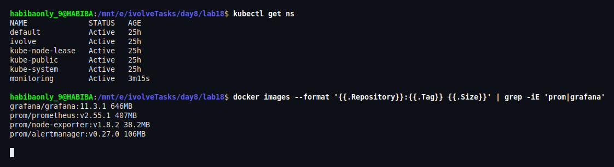
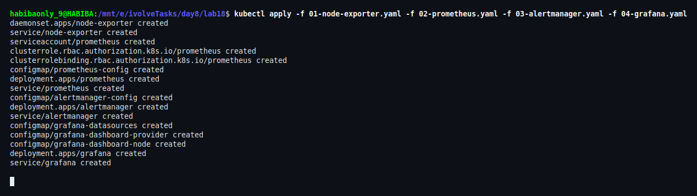
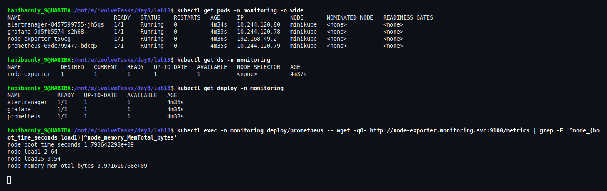
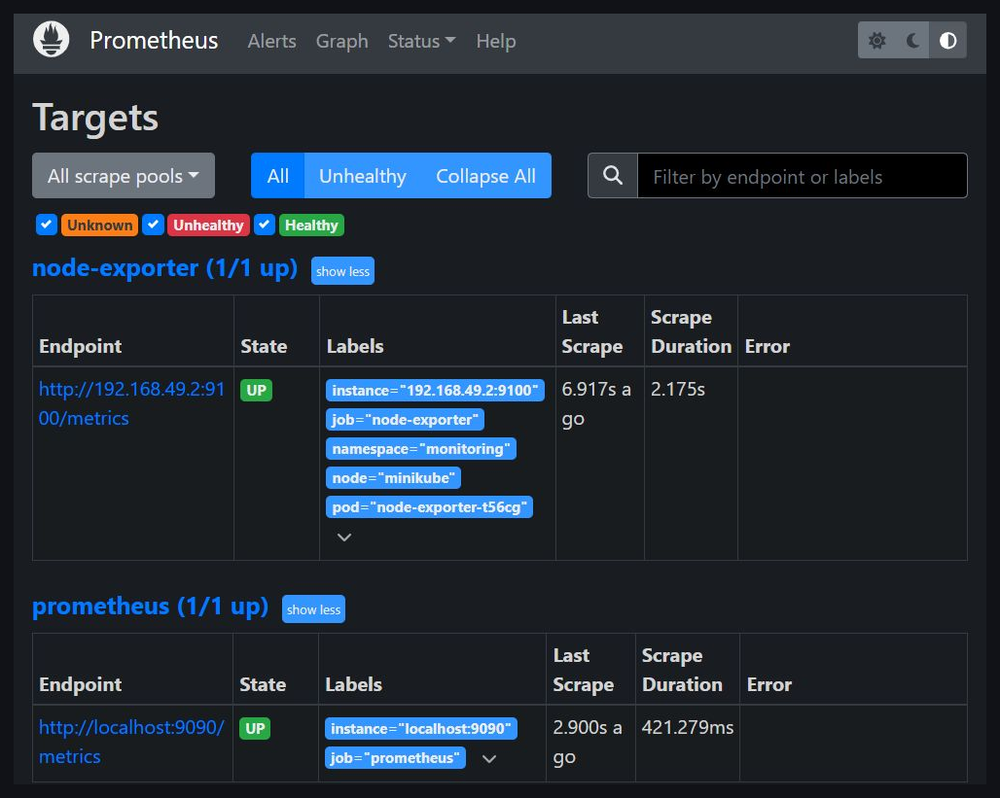
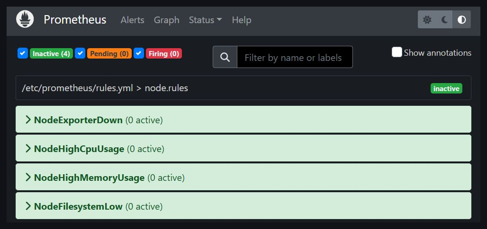
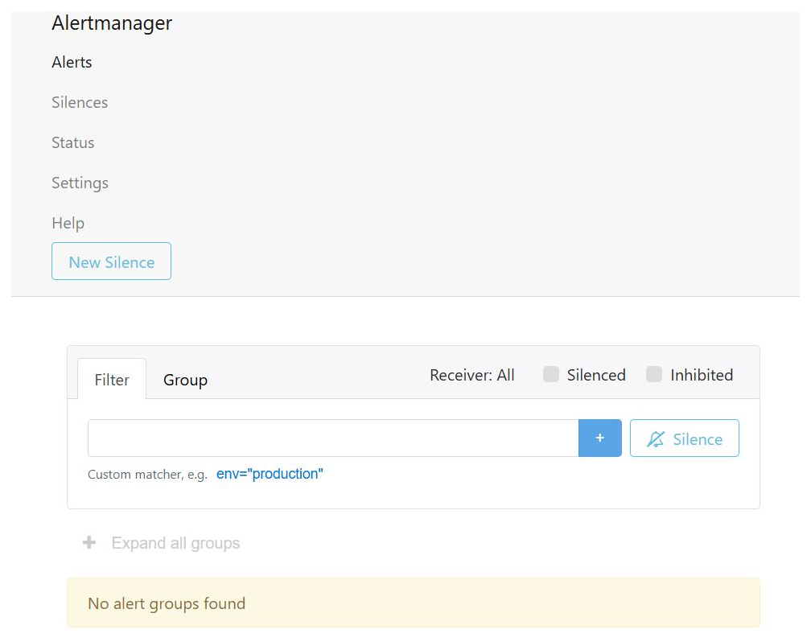
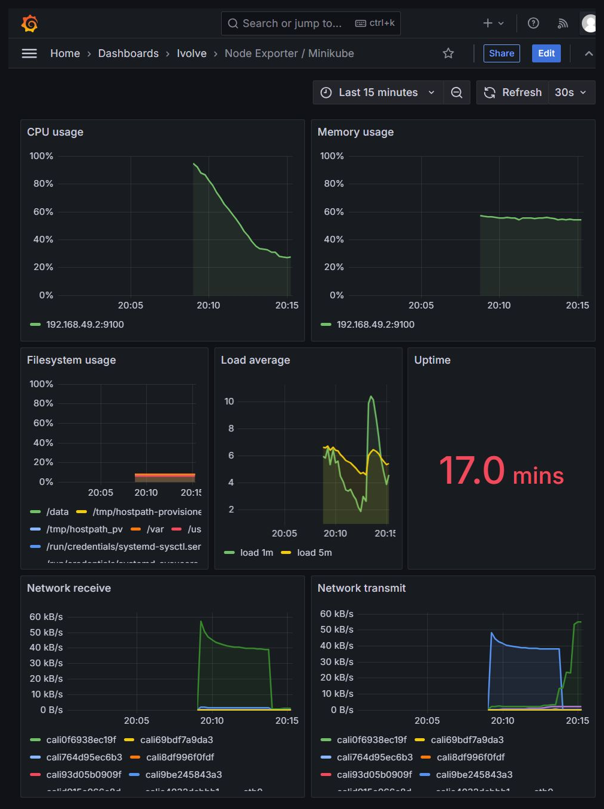

# Lab 18: Node-Wide Pod Management with DaemonSet

Monitoring stack for the cluster: **node-exporter** on every node, **Prometheus** to scrape it, **Alertmanager** for alerts, and **Grafana** to visualise everything — all in the `monitoring` namespace.

| Component | Kind | Role |
|---|---|---|
| node-exporter | **DaemonSet** | One Pod on every node, exposes node metrics on `:9100` |
| prometheus | Deployment | Scrapes node-exporter, evaluates alert rules |
| alertmanager | Deployment | Receives firing alerts from Prometheus |
| grafana | Deployment | Dashboards, provisioned from ConfigMaps |

## Files

```
lab18/
├── 00-namespace.yaml              # monitoring namespace
├── 01-node-exporter.yaml          # DaemonSet + headless Service
├── 02-prometheus.yaml             # RBAC, config + rules, Deployment, Service
├── 03-alertmanager.yaml           # config, Deployment, Service
├── 04-grafana.yaml                # datasource/dashboard provisioning, Deployment, Service
├── 04-grafana-secret.example.yaml # shape of the admin Secret (real one is not committed)
└── screenshots/
```

---

## 1. Namespace and images

```bash
kubectl apply -f 00-namespace.yaml
```

The four images are pulled to the host once and loaded into the node (`minikube image load`) so the Pods start without pulling from the registry:

| Image | Size |
|---|---|
| `prom/node-exporter:v1.8.2` | 38.2MB |
| `prom/alertmanager:v0.27.0` | 106MB |
| `prom/prometheus:v2.55.1` | 407MB |
| `grafana/grafana:11.3.1` | 646MB |



## 2. Apply the monitoring stack

The Grafana admin password comes from a Secret that is created by hand and never committed:

```bash
kubectl create secret generic grafana-admin -n monitoring \
  --from-literal=admin-password='<your-password>'

kubectl apply -f 01-node-exporter.yaml -f 02-prometheus.yaml \
  -f 03-alertmanager.yaml -f 04-grafana.yaml
```

16 objects: one DaemonSet, three Deployments, four Services, five ConfigMaps, one ServiceAccount and two RBAC objects.



## 3. DaemonSet: one exporter per node

```bash
kubectl get pods -n monitoring -o wide
kubectl get ds -n monitoring
kubectl get deploy -n monitoring

# the WSL host cannot route the Calico node IP, so the metrics are read from inside the cluster
kubectl exec -n monitoring deploy/prometheus -- \
  wget -qO- http://node-exporter.monitoring.svc:9100/metrics \
  | grep -E '^node_(boot_time_seconds|load1)|^node_memory_MemTotal_bytes'
```

`DESIRED 1 / READY 1` because the cluster has one node. The exporter Pod carries the node IP (`192.168.49.2`) because it uses `hostNetwork`, so the metrics belong to the node and not to a container.



## 4. Prometheus targets

```bash
kubectl port-forward -n monitoring svc/prometheus 9090:9090
```

`node-exporter` is discovered through the Kubernetes API (`role: pod`, `app=node-exporter`) and scraped on port `9100`. Both jobs are `UP` on `http://localhost:9090/targets`.



## 5. Alert rules

Open `http://localhost:9090/alerts` (same port-forward as the previous step).

Four rules are loaded from `rules.yml`: exporter down, high CPU, high memory, low disk. All are inactive on a healthy node.



## 6. Alertmanager

```bash
kubectl port-forward -n monitoring svc/alertmanager 9093:9093
```

Prometheus sends alerts to `alertmanager:9093`; the receiver is the default one (no external integration in this lab). The UI at `http://localhost:9093` shows no alert groups.



## 7. Grafana dashboard

```bash
kubectl port-forward -n monitoring svc/grafana 3000:3000
```

The Prometheus datasource and the dashboard are provisioned from ConfigMaps, so no manual import is needed. Open `http://localhost:3000`, log in as `admin` with the password from the Secret, then open **Dashboards → Ivolve → Node Exporter / Minikube**. Panels: CPU, memory, filesystem, load average, uptime and network throughput.



---

## Design notes

- **Why a DaemonSet:** node metrics are per-node. A Deployment would put an arbitrary number of exporters on arbitrary nodes, and nodes without an exporter would have no data. The DaemonSet scheduler places exactly one Pod per node.
- **hostNetwork + hostPort 9100:** with a per-node exporter, the Pod IP is the node IP, so Prometheus scrapes `node_ip:9100` directly and the metrics describe the host (`/proc`, `/sys`, `/` are mounted read-only).
- **Discovery, not a static target list:** Prometheus watches Pods with `app=node-exporter` and rewrites the address to `<pod_ip>:9100`. Adding a node adds a target automatically.
- **Storage:** Prometheus and Alertmanager use `emptyDir` (6h retention) because this is a lab cluster; production would use a PVC.
- **Grafana credentials:** the admin password lives in a Secret that is created with `kubectl` and never committed. `04-grafana-secret.example.yaml` shows the expected key only.

## Cleanup

```bash
kubectl delete -f 01-node-exporter.yaml -f 02-prometheus.yaml \
  -f 03-alertmanager.yaml -f 04-grafana.yaml
kubectl delete -f 00-namespace.yaml
```
