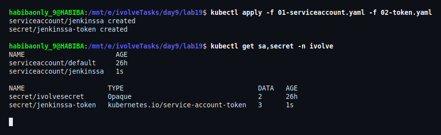
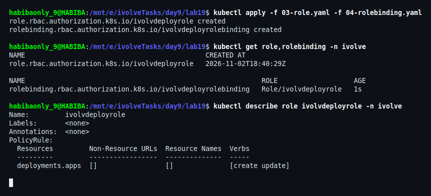
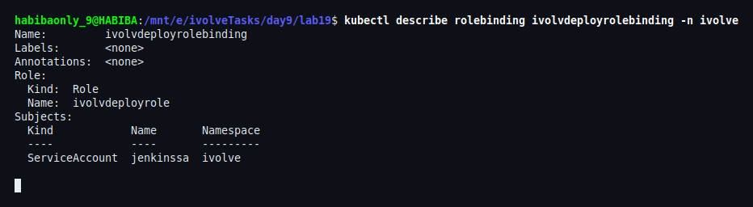
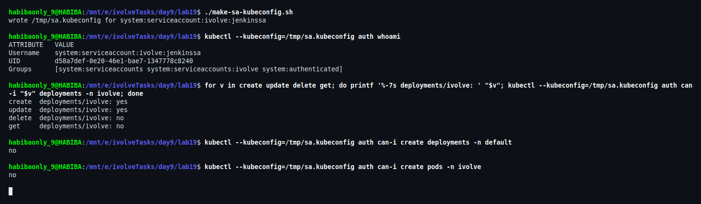
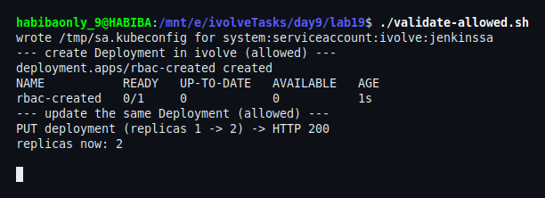
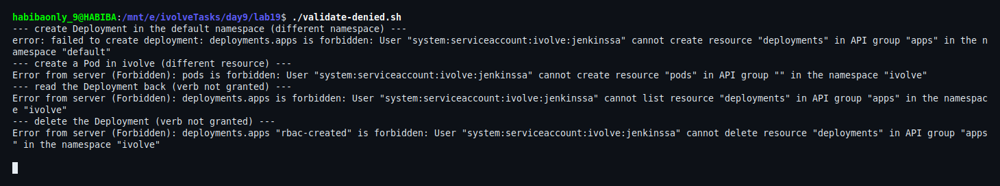

# Lab 19: Securing Kubernetes with RBAC and Service Accounts

Jenkins needs to deploy to the `ivolve` namespace without being cluster-admin. This lab gives it a dedicated identity (ServiceAccount + token) and a namespaced Role that allows **only `create` and `update` on Deployments** — then proves the limits with that token.

## Files

```
lab19/
├── 00-namespace.yaml             # ivolve namespace
├── 01-serviceaccount.yaml        # ServiceAccount jenkinssa
├── 02-token.yaml                 # long-lived token Secret for jenkinssa
├── 03-role.yaml                  # Role ivolvdeployrole (deployments: create, update)
├── 04-rolebinding.yaml           # RoleBinding ivolvdeployrolebinding -> jenkinssa
├── 05-test-deployment.yaml       # applied BY the ServiceAccount during validation
├── make-sa-kubeconfig.sh         # kubeconfig that authenticates as the ServiceAccount only
├── validate-allowed.sh           # proves create + update work
├── validate-denied.sh            # proves everything else is rejected
└── screenshots/
```

## Naming

`metadata.name` must be a lowercase DNS label, so the camelCase names from the lab sheet are written lowercase:

| Lab sheet | Manifest |
|---|---|
| `jenkinsSA` | `jenkinssa` |
| `ivolveDeployRole` | `ivolvdeployrole` |
| `ivolveDeployRoleBinding` | `ivolvdeployrolebinding` |

---

## 1. ServiceAccount and token

The `ivolve` namespace already exists from Lab 14 (it is also in `00-namespace.yaml` for a clean cluster).

```bash
kubectl apply -f 01-serviceaccount.yaml -f 02-token.yaml
kubectl get sa,secret -n ivolve
```

`jenkinssa-token` is a Secret of type `kubernetes.io/service-account-token`; the token controller fills its `token` key, so it does not expire like a `kubectl create token` token.



## 2. Role and RoleBinding

```bash
kubectl apply -f 03-role.yaml -f 04-rolebinding.yaml
kubectl describe role ivolvdeployrole -n ivolve
```

The effective rule is exactly one line: `deployments.apps` with verbs `[create update]` — no `get`, `list`, `delete`, or any other resource.



## 3. The binding points at the ServiceAccount

```bash
kubectl describe rolebinding ivolvdeployrolebinding -n ivolve
```

`Role: ivolvdeployrole` and `Subject: ServiceAccount jenkinssa (ivolve)` — a namespaced binding, so nothing outside `ivolve` is affected.



## 4. Authenticate as the ServiceAccount

```bash
./make-sa-kubeconfig.sh
kubectl --kubeconfig=/tmp/sa.kubeconfig auth whoami
kubectl --kubeconfig=/tmp/sa.kubeconfig auth can-i create deployments -n ivolve
kubectl --kubeconfig=/tmp/sa.kubeconfig auth can-i update deployments -n ivolve
kubectl --kubeconfig=/tmp/sa.kubeconfig auth can-i delete deployments -n ivolve
kubectl --kubeconfig=/tmp/sa.kubeconfig auth can-i create deployments -n default
kubectl --kubeconfig=/tmp/sa.kubeconfig auth can-i create pods -n ivolve
```

`whoami` returns `system:serviceaccount:ivolve:jenkinssa`, and the matrix is `yes` only for create/update in `ivolve`.



## 5. Prove create and update work

```bash
./validate-allowed.sh
```

The script creates `05-test-deployment.yaml` with the ServiceAccount token (create), then changes `replicas` from 1 to 2 with an API `PUT` (update) — HTTP 200.



## 6. Prove the rest is denied

```bash
./validate-denied.sh
```

The same token gets `Forbidden` for: creating a Deployment in `default`, creating a Pod in `ivolve`, reading the Deployment, and deleting it.



---

## Verification

| Requirement | Evidence |
|---|---|
| ServiceAccount `jenkinsSA` in `ivolve` | Step 1 — `serviceaccount/jenkinssa created` |
| Token for the ServiceAccount | Step 1 — `secret/jenkinssa-token` type `kubernetes.io/service-account-token`, 3 keys |
| Role `ivolveDeployRole` (create/update deployments) | Step 2 — `PolicyRule: deployments.apps [create update]` |
| RoleBinding `ivolveDeployRoleBinding` → `jenkinsSA` | Step 3 — subject row + step 2 listing |
| Only create/update in `ivolve` works | Steps 4–6 — matrix, real create/update, four `Forbidden` answers |

## Notes

- **Why the token Secret:** it produces a non-expiring token, which is what a CI server stores as a credential. `kubectl create token` is fine for short-lived runs but expires (1h by default).
- **Why a separate kubeconfig:** `kubectl --token=...` together with a kubeconfig that also contains a client certificate still authenticates with the certificate. The first test looked successful for that reason. `make-sa-kubeconfig.sh` writes a kubeconfig with the token only, so every result in steps 4–6 is really evaluated as `jenkinssa`.
- **No read permission is intentional:** the Role grants `create`/`update` only. If the pipeline needs `kubectl rollout status`, add `get`/`list`/`watch` — it is a deliberate trade-off, not an oversight.
- **Role, not ClusterRole:** the permissions are namespace-scoped, so the same ServiceAccount cannot touch any other namespace (step 6, `default`).
- **The token is a credential:** the scripts read it from the Secret at runtime; it is never written to a file in this repo.

## Cleanup

```bash
kubectl delete -f 05-test-deployment.yaml --ignore-not-found
kubectl delete -f 04-rolebinding.yaml -f 03-role.yaml -f 02-token.yaml -f 01-serviceaccount.yaml
rm -f /tmp/sa.kubeconfig
```
