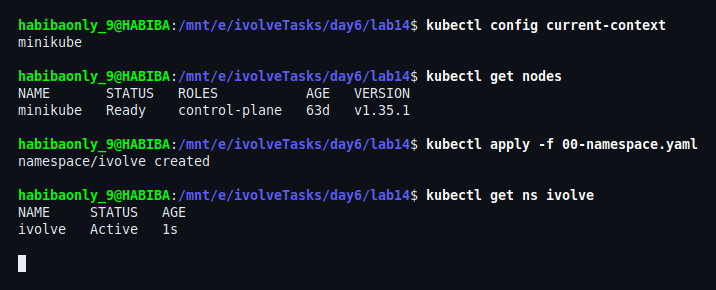
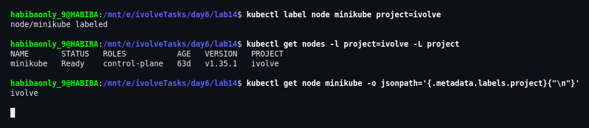
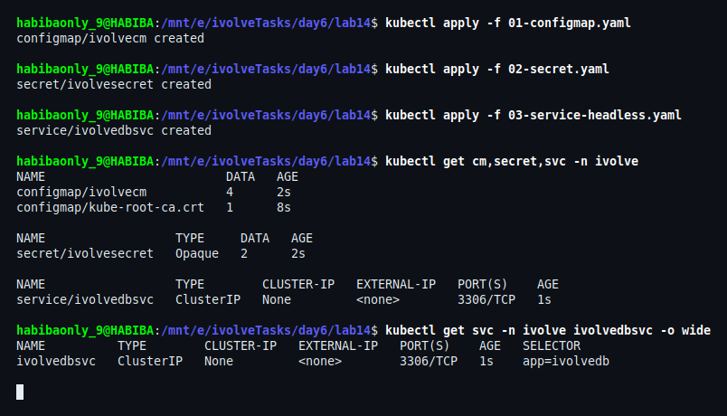
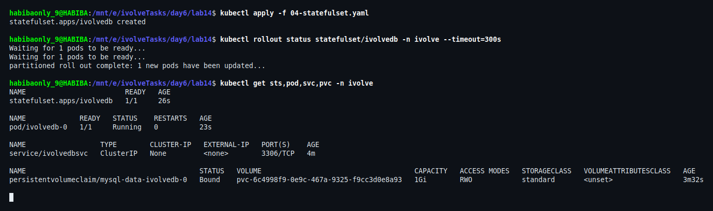
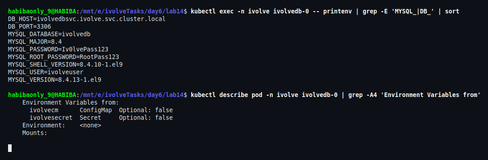
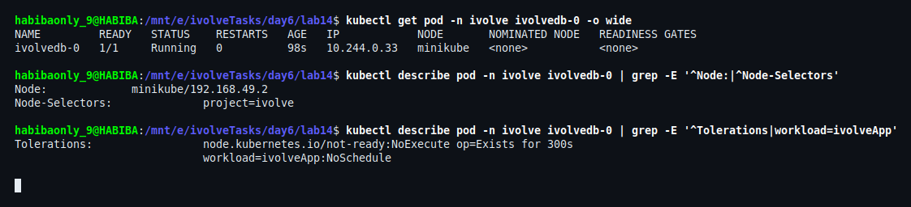
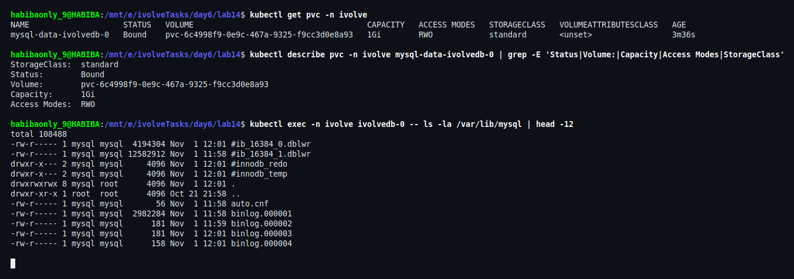
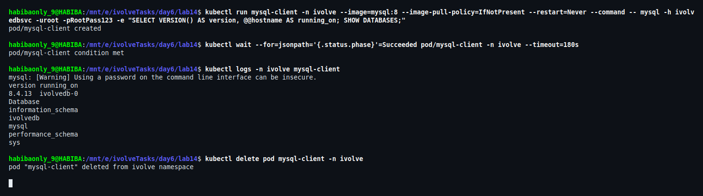
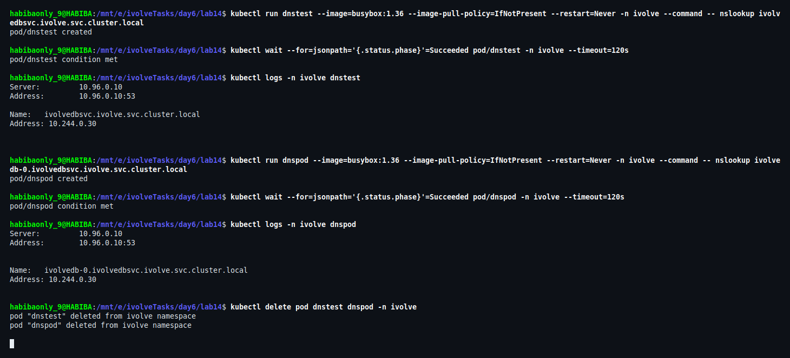
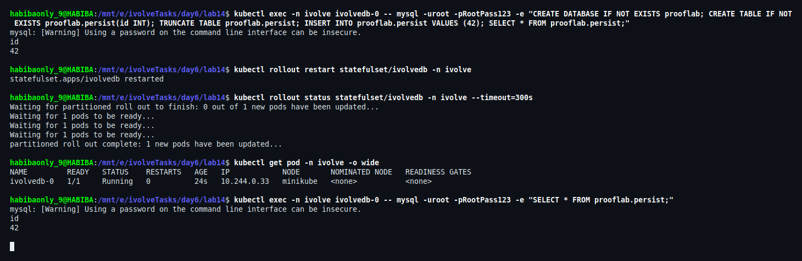

# Lab 14: StatefulSet with Headless Service

## Overview

This lab deploys a single-instance **MySQL 8** database on Kubernetes using a **StatefulSet** (`ivolvedb`) in the `ivolve` namespace, fronted by a **Headless Service** (`ivolvedbsvc`).

Unlike a Deployment, a StatefulSet gives the Pod a stable identity (a predictable Pod name and DNS record) and stable storage that survives Pod recreation — which is exactly what a database workload needs. The Pod configuration (database name, user, passwords) is injected from a ConfigMap and a Secret, and scheduling is constrained to a labelled node with the appropriate toleration.

## Objectives

1. Create `ivolveDB` StatefulSet in the `ivolve` namespace with `1` replica running MySQL.
2. Configure the StatefulSet Pod to consume environment variables from the ConfigMap and Secret.
3. Add a node selector so the Pod runs only on a node labelled `project=ivolve`.
4. Add a toleration with key `workload`, value `ivolveApp`, effect `NoSchedule`.
5. Configure a PersistentVolumeClaim template mounted at `/var/lib/mysql`.
6. Write a YAML manifest for a Headless Service named `ivolveDBSvc` targeting the MySQL StatefulSet Pod.
7. Confirm the database is operational by connecting with a MySQL client.
8. Verify MySQL Pod DNS resolution inside the cluster.

---

## Environment

| Component | Version |
|---|---|
| Docker | 29.8.0 |
| Minikube | v1.38.1 (docker driver) |
| Kubernetes | v1.35.1 |
| Host | WSL2 Ubuntu 26.04 |
| Database image | `mysql:8` (loaded into the node from the local Docker cache) |
| Namespace | `ivolve` |
| Node | `minikube` |

---

## Note on Naming

The lab sheet uses camelCase names (`ivolveDB`, `ivolveDBSvc`). Kubernetes **rejects** camelCase for `metadata.name`: names must be lowercase DNS labels (RFC 1123 / DNS-1035).

```
metadata.name: Invalid value: "ivolveDB": a lowercase RFC 1123 subdomain must consist of lower case
alphanumeric characters, '-' or '.', and must start and end with an alphanumeric character
```

Therefore the manifests in this lab use the lowercase equivalents:

| Lab requirement | Deployed name |
|---|---|
| StatefulSet `ivolveDB` | `ivolvedb` |
| Headless Service `ivolveDBSvc` | `ivolvedbsvc` |

The resulting stable DNS records are:

- Service: `ivolvedbsvc.ivolve.svc.cluster.local`
- Pod: `ivolvedb-0.ivolvedbsvc.ivolve.svc.cluster.local`

---

## File Structure

```
lab14/
├── 00-namespace.yaml       # Namespace: ivolve
├── 01-configmap.yaml       # ConfigMap: ivolvecm  (non-sensitive DB config)
├── 02-secret.example.yaml  # Secret template (the real 02-secret.yaml is git-ignored)
├── 03-service-headless.yaml# Service: ivolvedbsvc (clusterIP: None)
├── 04-statefulset.yaml     # StatefulSet: ivolvedb (MySQL + PVC template)
├── README.md
└── screenshots/            # Execution and verification evidence
```

> The real Secret manifest (`02-secret.yaml`) is **not committed**. Only the template
> `02-secret.example.yaml` is published; the live file is listed in `.gitignore`.

---

## Manifest Definitions

### 1. Namespace (`00-namespace.yaml`)

```yaml
apiVersion: v1
kind: Namespace
metadata:
  name: ivolve
```

### 2. ConfigMap (`01-configmap.yaml`)

Holds the non-sensitive database configuration consumed by the MySQL container.

```yaml
apiVersion: v1
kind: ConfigMap
metadata:
  name: ivolvecm
  namespace: ivolve
  labels:
    app: ivolvedb
data:
  MYSQL_DATABASE: "ivolvedb"
  MYSQL_USER: "ivolveuser"
  DB_HOST: "ivolvedbsvc.ivolve.svc.cluster.local"
  DB_PORT: "3306"
```

### 3. Secret (`02-secret.example.yaml` → `02-secret.yaml`)

Holds the database credentials. The repository only ships the **template**:

```yaml
apiVersion: v1
kind: Secret
metadata:
  name: ivolvesecret
  namespace: ivolve
  labels:
    app: ivolvedb
type: Opaque
data:
  MYSQL_ROOT_PASSWORD: REPLACE_WITH_BASE64_ROOT_PASSWORD
  MYSQL_PASSWORD: REPLACE_WITH_BASE64_APP_PASSWORD
```

Create the real manifest from the template, fill in base64-encoded values, then apply it:

```bash
cp 02-secret.example.yaml 02-secret.yaml

# base64 is encoding, not encryption — keep the real values out of git
printf %s 'your-root-password' | base64     # paste into MYSQL_ROOT_PASSWORD
printf %s 'your-app-password'  | base64     # paste into MYSQL_PASSWORD

kubectl apply -f 02-secret.yaml
```

> `02-secret.yaml` is git-ignored, so the value never reaches GitHub. The screenshots in this
> lab show the lab-only dummy credentials that were used on the local Minikube cluster.

### 4. Headless Service (`03-service-headless.yaml`)

`clusterIP: None` removes the virtual IP, so DNS returns the Pod IP directly. `publishNotReadyAddresses` keeps the Pod's DNS record available during startup, which is what makes StatefulSet peer-discovery reliable.

```yaml
apiVersion: v1
kind: Service
metadata:
  name: ivolvedbsvc
  namespace: ivolve
  labels:
    app: ivolvedb
spec:
  clusterIP: None
  selector:
    app: ivolvedb
  ports:
    - name: mysql
      port: 3306
      targetPort: 3306
      protocol: TCP
  publishNotReadyAddresses: true
```

### 5. StatefulSet (`04-statefulset.yaml`)

```yaml
apiVersion: apps/v1
kind: StatefulSet
metadata:
  name: ivolvedb
  namespace: ivolve
  labels:
    app: ivolvedb
spec:
  serviceName: ivolvedbsvc
  replicas: 1
  selector:
    matchLabels:
      app: ivolvedb
  template:
    metadata:
      labels:
        app: ivolvedb
    spec:
      nodeSelector:
        project: ivolve
      tolerations:
        - key: workload
          operator: Equal
          value: ivolveApp
          effect: NoSchedule
      terminationGracePeriodSeconds: 30
      containers:
        - name: mysql
          image: mysql:8
          imagePullPolicy: IfNotPresent
          ports:
            - name: mysql
              containerPort: 3306
          envFrom:
            - configMapRef:
                name: ivolvecm
            - secretRef:
                name: ivolvesecret
          volumeMounts:
            - name: mysql-data
              mountPath: /var/lib/mysql
          resources:
            requests:
              cpu: "100m"
              memory: "512Mi"
          readinessProbe:
            exec:
              command:
                - bash
                - -c
                - mysqladmin ping -h 127.0.0.1 -uroot -p"$MYSQL_ROOT_PASSWORD"
            initialDelaySeconds: 20
            periodSeconds: 10
            timeoutSeconds: 5
          livenessProbe:
            exec:
              command:
                - bash
                - -c
                - mysqladmin ping -h 127.0.0.1 -uroot -p"$MYSQL_ROOT_PASSWORD"
            initialDelaySeconds: 60
            periodSeconds: 20
            timeoutSeconds: 5
  volumeClaimTemplates:
    - metadata:
        name: mysql-data
      spec:
        accessModes:
          - ReadWriteOnce
        storageClassName: standard
        resources:
          requests:
            storage: 1Gi
```

The `volumeClaimTemplates` block is what makes the storage part of the Pod identity: Kubernetes creates `mysql-data-ivolvedb-0` and re-attaches it every time Pod `ivolvedb-0` is created — and it is **not** deleted when the StatefulSet or the Pod is deleted.

---

## Steps and Verification

### Step 0: Prepare the Image Offline

`mysql:8` already existed in the local Docker cache, so it was loaded into the Minikube node without pulling it from the internet:

```bash
docker save mysql:8 -o mysql8.tar
minikube image load mysql8.tar
```

### Step 1: Create the Namespace

```bash
kubectl config current-context
kubectl get nodes
kubectl apply -f 00-namespace.yaml
kubectl get ns ivolve
```

The current context is `minikube`, the single node is `Ready`, and the `ivolve` namespace is created and `Active`.



### Step 2: Label the Node

The StatefulSet uses `nodeSelector: project=ivolve`, so the node must carry that label:

```bash
kubectl label node minikube project=ivolve
kubectl get nodes -l project=ivolve -L project
```

The node is reported with `PROJECT=ivolve`.



### Step 3: Create the ConfigMap, Secret and Headless Service

```bash
cp 02-secret.example.yaml 02-secret.yaml     # fill in the real base64 values first
kubectl apply -f 01-configmap.yaml
kubectl apply -f 02-secret.yaml
kubectl apply -f 03-service-headless.yaml
kubectl get cm,secret,svc -n ivolve
kubectl get svc -n ivolve ivolvedbsvc -o wide
```

The Service `ivolvedbsvc` is created as `ClusterIP None` — the defining property of a Headless Service — and selects the Pods with `app=ivolvedb`.



### Step 4: Create the StatefulSet

```bash
kubectl apply -f 04-statefulset.yaml
kubectl rollout status statefulset/ivolvedb -n ivolve --timeout=300s
kubectl get sts,pod,svc,pvc -n ivolve
```

A single Pod named `ivolvedb-0` is created, reaches `1/1 Running`, and the PVC `mysql-data-ivolvedb-0` is provisioned and `Bound`.



### Step 5: Verify Environment Variables from ConfigMap and Secret

```bash
kubectl exec -n ivolve ivolvedb-0 -- printenv | grep -E 'MYSQL_|DB_' | sort
kubectl describe pod -n ivolve ivolvedb-0 | grep -A4 'Environment Variables from'
```

The container receives `MYSQL_DATABASE`, `MYSQL_USER`, `DB_HOST`, `DB_PORT` from the ConfigMap and `MYSQL_ROOT_PASSWORD`, `MYSQL_PASSWORD` from the Secret. `describe` confirms both sources are `ivolvecm` (ConfigMap) and `ivolvesecret` (Secret).



### Step 6: Verify Scheduling Rules

```bash
kubectl get pod -n ivolve ivolvedb-0 -o wide
kubectl describe pod -n ivolve ivolvedb-0 | grep -E '^Node:|^Node-Selectors'
kubectl describe pod -n ivolve ivolvedb-0 | grep -E '^Tolerations|workload=ivolveApp'
```

The Pod runs on node `minikube`, shows `Node-Selectors: project=ivolve`, and carries the toleration `workload=ivolveApp:NoSchedule`.



### Step 7: Verify the PVC and the Mount Path

```bash
kubectl get pvc -n ivolve
kubectl describe pvc -n ivolve mysql-data-ivolvedb-0 | grep -E 'Status|Volume:|Capacity|Access Modes|StorageClass'
kubectl exec -n ivolve ivolvedb-0 -- ls -la /var/lib/mysql | head -12
```

The claim created from the template is `Bound` with `1Gi` and `RWO`, and the MySQL data files (`ibdata1`, `binlog.*`, `mysql/`, ...) are physically written to the mounted volume at `/var/lib/mysql`.



### Step 8: Connect with a MySQL Client Through the Headless Service

Read the root password from the Secret instead of hardcoding it:

```bash
ROOT_PW=$(kubectl get secret ivolvesecret -n ivolve \
  -o jsonpath='{.data.MYSQL_ROOT_PASSWORD}' | base64 -d)

kubectl run mysql-client -n ivolve --image=mysql:8 --image-pull-policy=IfNotPresent \
  --restart=Never --command -- mysql -h ivolvedbsvc -uroot -p"$ROOT_PW" \
  -e "SELECT VERSION() AS version, @@hostname AS running_on; SHOW DATABASES;"

kubectl wait --for=jsonpath='{.status.phase}'=Succeeded pod/mysql-client -n ivolve --timeout=180s
kubectl logs -n ivolve mysql-client
kubectl delete pod mysql-client -n ivolve
```

The client connects using the **Service name** (not an IP), reports MySQL `8.4.13`, resolves to the backend Pod `ivolvedb-0`, and lists the `ivolvedb` database created from the ConfigMap.



### Step 9: Verify MySQL Pod DNS Resolution

```bash
kubectl run dnstest --image=busybox:1.36 --image-pull-policy=IfNotPresent --restart=Never \
  -n ivolve --command -- nslookup ivolvedbsvc.ivolve.svc.cluster.local

kubectl run dnspod --image=busybox:1.36 --image-pull-policy=IfNotPresent --restart=Never \
  -n ivolve --command -- nslookup ivolvedb-0.ivolvedbsvc.ivolve.svc.cluster.local

kubectl logs -n ivolve dnstest
kubectl logs -n ivolve dnspod
kubectl delete pod dnstest dnspod -n ivolve
```

Both names resolve to the same Pod IP (`10.244.0.30` at the time of the test), confirming that the Headless Service provides the stable per-Pod DNS identity:

- `ivolvedbsvc.ivolve.svc.cluster.local` → Pod IP
- `ivolvedb-0.ivolvedbsvc.ivolve.svc.cluster.local` → Pod IP



### Step 10: Prove the Storage is Persistent

```bash
kubectl exec -n ivolve ivolvedb-0 -- mysql -uroot -p"$ROOT_PW" \
  -e "CREATE DATABASE IF NOT EXISTS prooflab;
      CREATE TABLE IF NOT EXISTS prooflab.persist(id INT);
      TRUNCATE TABLE prooflab.persist;
      INSERT INTO prooflab.persist VALUES (42);
      SELECT * FROM prooflab.persist;"

kubectl rollout restart statefulset/ivolvedb -n ivolve
kubectl rollout status statefulset/ivolvedb -n ivolve --timeout=300s
kubectl get pod -n ivolve -o wide

kubectl exec -n ivolve ivolvedb-0 -- mysql -uroot -p"$ROOT_PW" \
  -e "SELECT * FROM prooflab.persist;"
```

The Pod is destroyed and recreated with the same name, and the row `42` is still present afterwards — the `volumeClaimTemplates` PVC survived the Pod lifecycle.



---

## Verification Summary

| Requirement | Verified evidence |
|---|---|
| StatefulSet `ivolvedb`, 1 replica, MySQL | Step 4 — `1/1 Running`, image `mysql:8` |
| Env from ConfigMap and Secret | Step 5 — variables + `Environment Variables from` |
| `nodeSelector: project=ivolve` | Step 2 and Step 6 |
| Toleration `workload=ivolveApp:NoSchedule` | Step 6 |
| PVC template mounted at `/var/lib/mysql` | Step 4 and Step 7 |
| Headless Service `ivolvedbsvc` | Step 3 — `CLUSTER-IP None` |
| MySQL client connectivity | Step 8 — version, hostname, databases |
| Pod DNS resolution | Step 9 — FQDN → Pod IP |

---

## Security Note

- The credentials used during this lab were **lab-only dummy values** on a local Minikube cluster.
- The live Secret manifest (`02-secret.yaml`) is **git-ignored**; only `02-secret.example.yaml` is published.
- Base64 is encoding, **not encryption** — Kubernetes Secrets are protected by RBAC and etcd encryption, not by base64.
- The commands in this README read the password from the cluster at runtime instead of hardcoding it.
- The screenshots show the dummy values because they are the evidence of the actual execution.

---

## Cleanup

```bash
kubectl delete -f 04-statefulset.yaml
kubectl delete -f 03-service-headless.yaml -f 02-secret.yaml -f 01-configmap.yaml
kubectl delete pvc -n ivolve --all
kubectl delete namespace ivolve
kubectl label node minikube project-
```

> `kubectl delete statefulset` does **not** remove the PVCs created by `volumeClaimTemplates`. They must be deleted explicitly — this is intentional, to protect the data.

## Conclusion

The MySQL StatefulSet was deployed with stable identity and stable storage: configuration is externalised into a ConfigMap and a Secret, scheduling is pinned to a labelled node and protected by a toleration, and the Headless Service provides predictable DNS names for both the Service and the individual Pod. Connectivity was proven with a MySQL client through the Service name, DNS resolution was verified from inside the cluster, and data persisted across a full Pod recreation.
