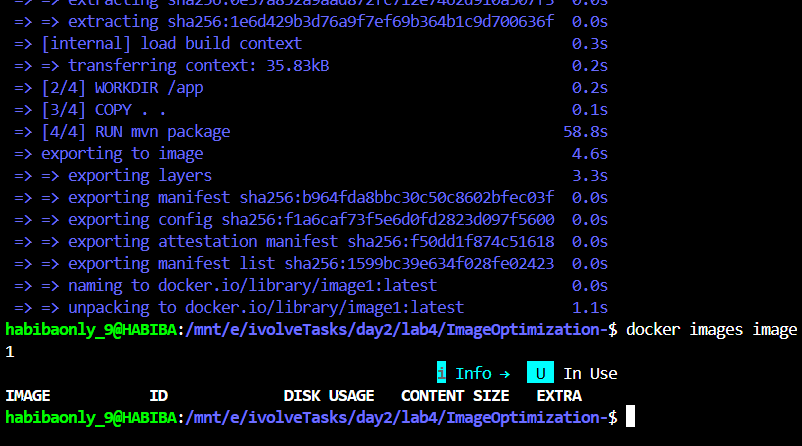
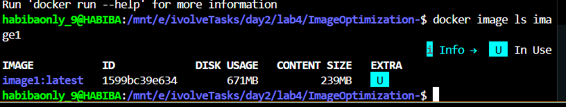
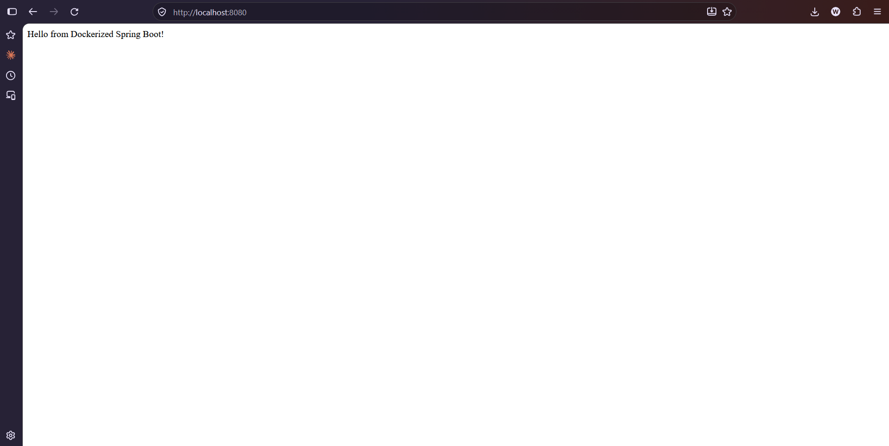
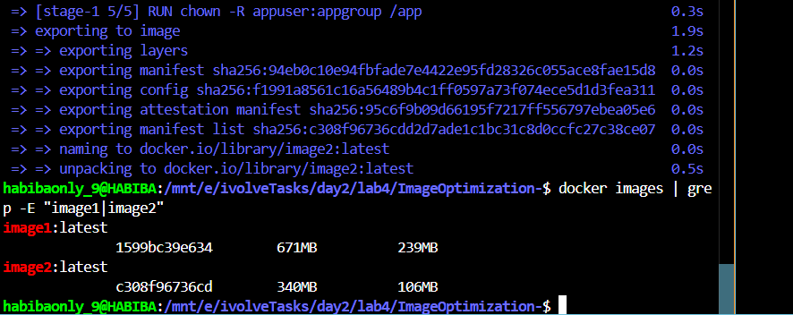
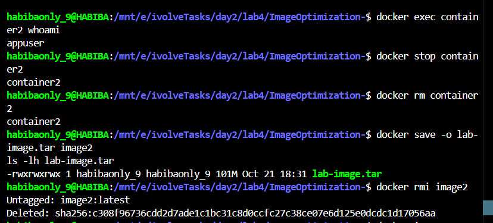
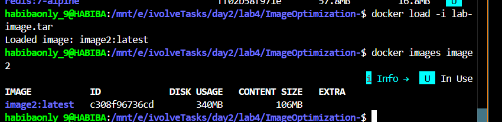

# Lab 4: Docker Image Optimization and Export/Load

A Spring Boot application used to demonstrate Docker image optimization using multi-stage builds and non-root user configuration.

---

## Steps

### 1. Clone the Repository

```bash
git clone https://github.com/Ibrahim-Adel15/ImageOptimization-.git
cd ImageOptimization-
```

---

### 2. Build image1 from the existing Dockerfile

```bash
docker build -t image1 .
```



---

### 3. Check image1 size

```bash
docker image ls image1
```



> image1 size: **671 MB** (DISK USAGE) — built with full Maven + JDK image

---

### 4. Run container1 from image1

```bash
docker run -d -p 8080:8080 --name container1 image1
```

---

### 5. Verify the application is working

Open the browser at `http://localhost:8080`



---

### 6. Stop and delete container1

```bash
docker stop container1
docker rm container1
```

---

### 7. Write a multi-stage Dockerfile with non-root user

Replace the existing `Dockerfile` with a multi-stage build that uses a lightweight JRE-only base image and runs as a non-root user:

```dockerfile

FROM maven:3.9.15-eclipse-temurin-17-alpine AS builder

WORKDIR /app

COPY pom.xml .
RUN mvn dependency:go-offline

COPY src ./src
RUN mvn package -DskipTests

FROM eclipse-temurin:17-jre-alpine

WORKDIR /app

# Create non-root user
RUN addgroup -S appgroup && adduser -S appuser -G appgroup

# Copy only the JAR from builder
COPY --from=builder /app/target/demo-0.0.1-SNAPSHOT.jar app.jar

# Change ownership to non-root user
RUN chown -R appuser:appgroup /app

USER appuser

EXPOSE 8080

CMD ["java", "-jar", "app.jar"]
```

---

### 8. Build image2 from the optimized Dockerfile

```bash
docker build -t image2 .
```

---

### 9. Compare image1 vs image2 size

```bash
docker images | grep -E "image1|image2"
```



| Image | Disk Usage | Content Size |
|-------|-----------|--------------|
| image1 | 671 MB | 239 MB |
| image2 | 340 MB | 106 MB |

> **image2 is ~50% smaller** thanks to the multi-stage build using JRE-only base image instead of full Maven + JDK.

---

### 10. Run container2 from image2

```bash
docker run -d -p 8080:8080 --name container2 image2
```

---

### 11. Verify the application is working and running as non-root user

Open the browser at `http://localhost:8080`


Verify non-root user:

```bash
docker exec container2 whoami
```



> Output: `appuser` — confirms the app is running as a **non-root user** 

---

### 12. Stop and delete container2

```bash
docker stop container2
docker rm container2
```

*(shown in the same screenshot above)*

---

### 13. Save image2 as a TAR file

```bash
docker save -o lab-image.tar image2
ls -lh lab-image.tar
```


> `lab-image.tar` created — size: **101 MB**

---

### 14. Delete image2 from local Docker host

```bash
docker rmi image2
```

*(shown in the same screenshot above — `Untagged: image2:latest`)*

---

### 15. Load the image from lab-image.tar

```bash
docker load -i lab-image.tar
```



> Output: `Loaded image: image2:latest` 

---

### 16. Verify the loaded image exists in local Docker host

```bash
docker images image2
```


> image2 is back in the local Docker host with **340 MB disk usage** 

---

## Summary

| Step | Action | Result |
|------|--------|--------|
| Build image1 | Single-stage Maven build | 671 MB |
| Build image2 | Multi-stage + JRE-only + non-root | 340 MB |
| Size reduction | — | ~50% smaller |
| Non-root user | `appuser` via `adduser` | Verified via `whoami` |
| Export | `docker save` | `lab-image.tar` 101 MB |
| Import | `docker load` | image2 restored successfully |
