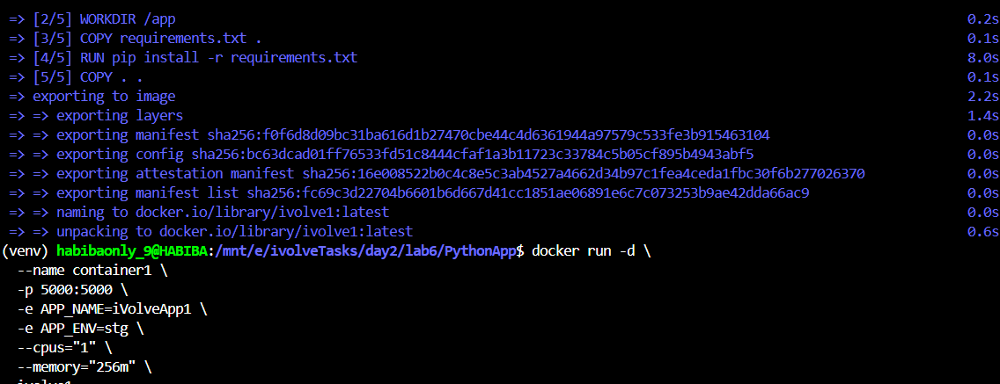
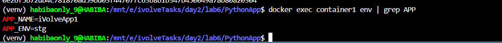
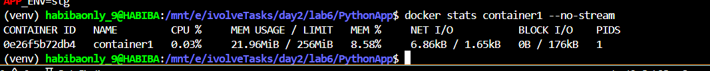
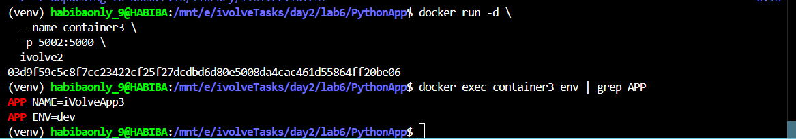

# Lab 6: Docker Environment Variables and Resource Management

A Python Flask application used to demonstrate Docker environment variables configuration and container resource management.

---

## Steps

### 1. Clone the Repository

```bash
git clone https://github.com/Ibrahim-Adel15/PythonApp.git
cd PythonApp
```

---

### 2. Create the Dockerfile

Create a `Dockerfile` using `python:3.12-slim` as the base image:

```dockerfile
FROM python:3.12-slim

WORKDIR /app

COPY requirements.txt .
RUN pip install -r requirements.txt

COPY . .

EXPOSE 5000

CMD ["python", "app.py"]
```

---

### 3. Build ivolve1 Docker image

```bash
docker build -t ivolve1 .
```

---

### 4. Run container1 with environment variables and resource limits

```bash
docker run -d \
  --name container1 \
  -p 5000:5000 \
  -e APP_NAME=iVolveApp1 \
  -e APP_ENV=stg \
  --cpus="1" \
  --memory="256m" \
  ivolve1
```



> Image built successfully and container1 started with APP_NAME=iVolveApp1, APP_ENV=stg, limited to 1 CPU and 256MB memory

---

### 5. Verify the application is working

Open the browser at `http://localhost:5000`

The response confirms the environment variables are applied:

```json
{
  "application": "iVolveApp1",
  "environment": "stg",
  "message": "Welcome to the Docker Env & Resource Management Lab!"
}
```

---

### 6. Verify the environment variables inside container1

```bash
docker exec container1 env | grep APP
```



> APP_NAME=iVolveApp1 and APP_ENV=stg confirmed inside the container

---

### 7. Monitor container1 CPU and memory usage

```bash
docker stats container1 --no-stream
```



> Memory usage: 21.96MiB / 256MiB — resource limit is applied correctly

---

### 8. Create env.txt file

```bash
cat > env.txt << EOF
APP_NAME=iVolveApp2
APP_ENV=prod
EOF
```

---

### 9. Run container2 loading environment variables from env.txt

```bash
docker run -d \
  --name container2 \
  -p 5001:5000 \
  --env-file env.txt \
  ivolve1
```

Verify the environment variables:

```bash
docker exec container2 env | grep APP
```

> APP_NAME=iVolveApp2 and APP_ENV=prod loaded from env.txt

---

### 10. Create a new Dockerfile with hardcoded environment variables

Create `Dockerfile.v2` with ENV variables hardcoded inside the Dockerfile:

```dockerfile
FROM python:3.12-slim

WORKDIR /app

COPY requirements.txt .
RUN pip install -r requirements.txt

COPY . .

ENV APP_NAME=iVolveApp3
ENV APP_ENV=dev

EXPOSE 5000

CMD ["python", "app.py"]
```

Build the new image:

```bash
docker build -t ivolve2 -f Dockerfile.v2 .
```

---

### 11. Run container3 from ivolve2 and validate the hardcoded ENV variables

```bash
docker run -d \
  --name container3 \
  -p 5002:5000 \
  ivolve2

docker exec container3 env | grep APP
```



> APP_NAME=iVolveApp3 and APP_ENV=dev confirmed — loaded directly from the Dockerfile

---

## Summary

| Container | Image | ENV Method | APP_NAME | APP_ENV | Resource Limit |
|-----------|-------|-----------|----------|---------|----------------|
| container1 | ivolve1 | -e flags at runtime | iVolveApp1 | stg | 1 CPU, 256MB |
| container2 | ivolve1 | --env-file env.txt | iVolveApp2 | prod | none |
| container3 | ivolve2 | ENV in Dockerfile | iVolveApp3 | dev | none |
