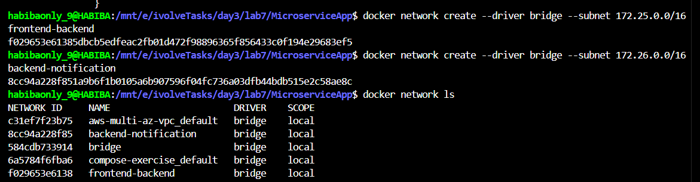
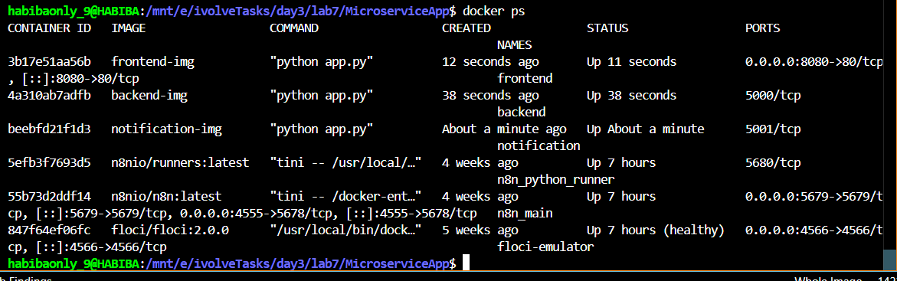
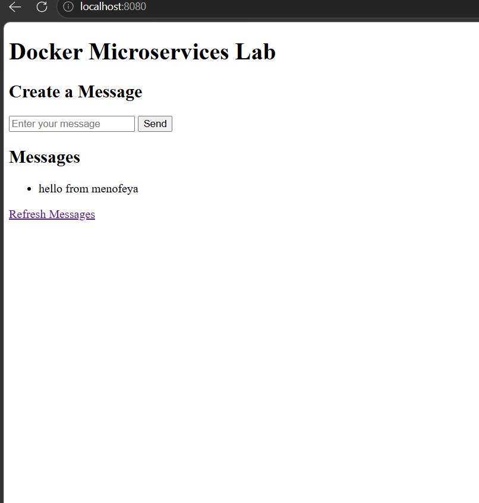
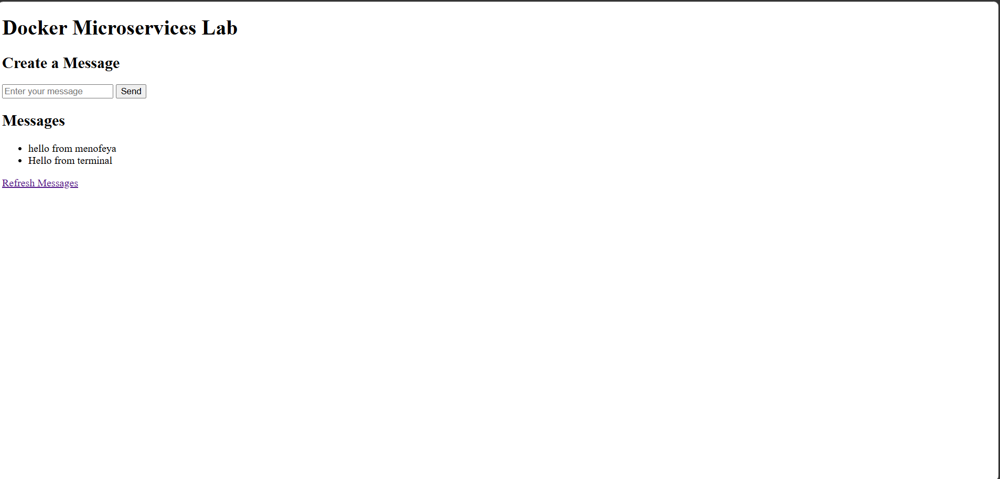

# Lab 7: Multi-Network Microservices, Volumes, and Bind Mounts

## Overview

This lab demonstrates containerizing a three-tier microservices application using Docker. The setup includes custom bridge networks with separate subnets, named volumes for log persistence, and a bind mount for backend data persistence.

### Architecture

```
[ frontend :3000 ] ──── frontend-backend (172.25.0.0/16) ──── [ backend :5000 ]
                                                                      |
                                                    backend-notification (172.26.0.0/16)
                                                                      |
                                                             [ notification :5001 ]
```

- **frontend** — Flask app that renders the UI and communicates with the backend
- **backend** — Flask API that stores messages to `/app/data/messages.json` and triggers notifications
- **notification** — Flask service that receives and logs notification events

---

## Prerequisites

- Docker installed and running
- Git installed

---

## Steps

### 1. Clone the Repository

```bash
git clone https://github.com/Ibrahim-Adel15/MicroserviceApp.git
cd MicroserviceApp
```

---

### 2. Build the Docker Images

Each service has its own `Dockerfile` under its directory.

```bash
docker build -t frontend-img ./frontend
docker build -t backend-img ./backend
docker build -t notification-img ./notification
```

Verify the images were created:

```bash
docker images
```


---

### 3. Create the Networks

Two bridge networks with separate subnets are created to isolate communication between services.

```bash
docker network create --driver bridge --subnet 172.25.0.0/16 frontend-backend
docker network create --driver bridge --subnet 172.26.0.0/16 backend-notification
```

- `frontend-backend` — connects the frontend and backend containers
- `backend-notification` — connects the backend and notification containers

Verify the networks were created:

```bash
docker network ls
```

**Screenshot — `docker network create` and `docker network ls` output showing both networks:**



---

### 4. Create the Volumes

Two named volumes are created to persist log data across container restarts.

```bash
docker volume create backend-logs
docker volume create notification-logs
```

Verify the volumes were created:

```bash
docker volume ls
```


---

### 5. Create the Host Directory for Bind Mount

A directory on the host machine is created to persist the backend message data.

```bash
mkdir -p ~/backend-data
```

This directory will be mounted into the backend container at `/app/data`, so `messages.json` is stored on the host and survives container deletion.

---

### 6. Run the Notification Container

```bash
docker run -d \
  --name notification \
  --network backend-notification \
  -v notification-logs:/app/logs \
  notification-img
```

- Runs on the `backend-notification` network only
- Logs are persisted in the `notification-logs` volume at `/app/logs/notification.log`
- Listens on port `5001`

---

### 7. Run the Backend Container

```bash
docker run -d \
  --name backend \
  --network frontend-backend \
  -v backend-logs:/app/logs \
  -v ~/backend-data:/app/data \
  -e NOTIFICATION_URL=http://notification:5001/notify \
  backend-img
```

Then connect it to the second network:

```bash
docker network connect backend-notification backend
```

- Connected to both networks so it can communicate with both frontend and notification
- Logs are persisted in the `backend-logs` volume at `/app/logs/backend.log`
- Message data is persisted via bind mount at `~/backend-data/messages.json` on the host
- `NOTIFICATION_URL` tells the backend where to send notification events

---

### 8. Run the Frontend Container

```bash
docker run -d \
  --name frontend \
  --network frontend-backend \
  -p 8080:3000 \
  -e BACKEND_URL=http://backend:5000 \
  frontend-img
```

- Runs on the `frontend-backend` network
- Port `8080` on the host maps to port `3000` inside the container
- `BACKEND_URL` tells the frontend where to reach the backend API

---

### 9. Verify All Containers Are Running

```bash
docker ps
```

All three containers should have status `Up`.

**Screenshot — `docker ps` output showing frontend, backend, and notification running:**



---

### 10. Test the Application

#### Send a message via curl

```bash
curl -X POST http://localhost:8080/send \
  -d "message=Hello from menofeya"
```

Expected response: a redirect to `/`

#### Retrieve messages from the backend

```bash
docker exec frontend python3 -c \
  "import requests; r = requests.get('http://backend:5000/messages'); print(r.json())"
```

Expected response:

```json
{"messages": ["Hello from menofeya"]}
```

#### Verify the data file was created on the host

```bash
cat ~/backend-data/messages.json
```

Expected output:

```json
[
  "Hello from terminal"
]
```

#### Check notification logs

```bash
docker logs notification
```

Expected output includes a line confirming the notification was received for the message.

**Screenshot — browser showing the application at `http://localhost:8080` with messages created and retrieved:**





---

## Project Structure

```
MicroserviceApp/
├── frontend/
│   ├── app.py            # Flask UI — renders form and message list, talks to backend
│   ├── Dockerfile
│   └── requirements.txt
├── backend/
│   ├── app.py            # Flask API — stores messages to JSON, sends notifications
│   ├── Dockerfile
│   └── requirements.txt
├── notification/
│   ├── app.py            # Flask service — receives and logs notification events
│   ├── Dockerfile
│   └── requirements.txt
└── README.md
```

---

## Network and Storage Summary

| Resource | Type | Purpose |
|----------|------|---------|
| `frontend-backend` | Bridge network `172.25.0.0/16` | Communication between frontend and backend |
| `backend-notification` | Bridge network `172.26.0.0/16` | Communication between backend and notification |
| `backend-logs` | Named volume | Persists backend log file across restarts |
| `notification-logs` | Named volume | Persists notification log file across restarts |
| `~/backend-data` | Bind mount | Persists `messages.json` on the host machine |

---

## Port Reference

| Service | Internal Port | Host Port |
|---------|--------------|-----------|
| frontend | 3000 | 8080 |
| backend | 5000 | not exposed |
| notification | 5001 | not exposed |

---

## Cleanup

To stop and remove all containers, networks, and volumes created in this lab:

```bash
docker rm -f frontend backend notification
docker network rm frontend-backend backend-notification
docker volume rm backend-logs notification-logs
rm -rf ~/backend-data
```
