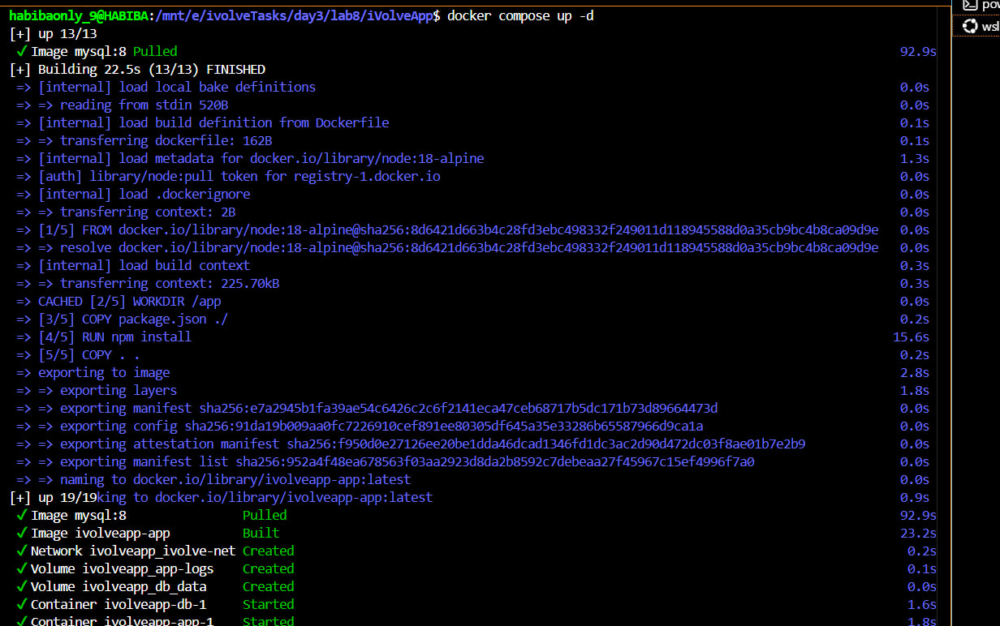
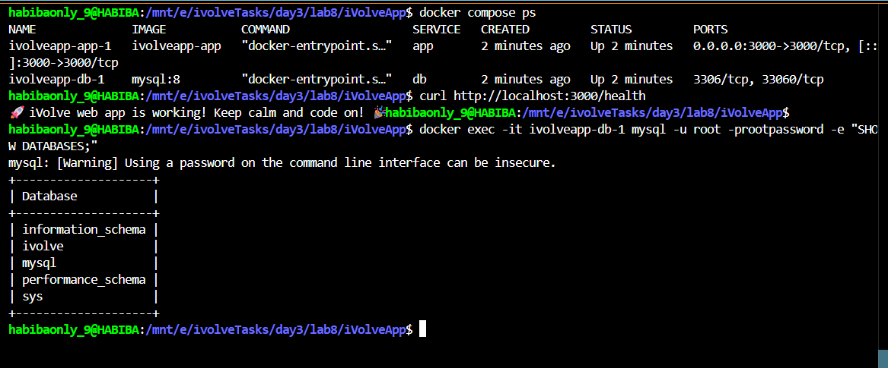
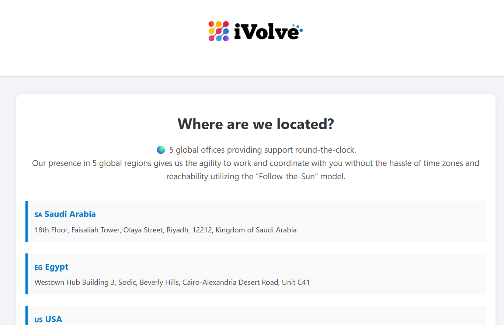
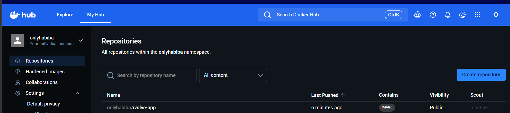

# Lab 8: Containerized Node.js and MySQL Stack Using Docker Compose

## Overview

This lab containerizes a Node.js e-commerce application with a MySQL database using Docker Compose. The setup includes a custom bridge network, named volumes for data and log persistence, and environment variable management through a `.env` file.

### Architecture

```
[ Node.js App :3000 ] ──── ivolve-net (bridge) ──── [ MySQL :3306 ]
        |                                                    |
   app-logs volume                                    db_data volume
   (/app/logs)                                       (/var/lib/mysql)
```

---

## Prerequisites

- Docker and Docker Compose installed and running
- Git installed
- Docker Hub account

---

## Steps

### 1. Clone the Repository

```bash
git clone https://github.com/Ibrahim-Adel15/iVolveApp.git
cd iVolveApp
```

---

### 2. Review the Application Requirements

The application requires:
- A MySQL connection using environment variables `DB_HOST`, `DB_USER`, `DB_PASSWORD`, `DB_NAME`
- A database named `ivolve` to exist before the app can start
- Application logs written to `/app/logs`

```bash
cat package.json
cat server.js
```

---

### 3. Create the Environment File

Create a `.env` file in the project root with the required credentials:

```
DB_HOST=db
DB_USER=root
DB_PASSWORD=rootpassword
DB_NAME=ivolve
MYSQL_ROOT_PASSWORD=rootpassword
MYSQL_DATABASE=ivolve
```

A `.env.example` file is also provided with placeholder values for reference.

---

### 4. Create docker-compose.yml

```yaml
services:
  app:
    build: .
    ports:
      - "3000:3000"
    env_file:
      - .env
    volumes:
      - app-logs:/app/logs
    networks:
      - ivolve-net
    depends_on:
      - db

  db:
    image: mysql:8
    env_file:
      - .env
    volumes:
      - db_data:/var/lib/mysql
    networks:
      - ivolve-net

networks:
  ivolve-net:
    driver: bridge

volumes:
  app-logs:
  db_data:
```

**What each section does:**

| Section | Purpose |
|---------|---------|
| `build: .` | Builds the app image from the Dockerfile in the project root |
| `ports: 3000:3000` | Exposes the app on port 3000 on the host |
| `env_file: .env` | Loads all environment variables from the `.env` file |
| `depends_on: db` | Ensures the database container starts before the app |
| `MYSQL_DATABASE: ivolve` | MySQL image automatically creates this database on first start |
| `ivolve-net` | Custom bridge network so app and db can communicate by service name |
| `app-logs` | Named volume persisting application logs at `/app/logs` |
| `db_data` | Named volume persisting MySQL data at `/var/lib/mysql` |

---

### 5. Start the Services

```bash
docker compose up -d
```

Docker Compose pulls the MySQL image, builds the Node.js app image, creates the network and volumes, then starts both containers.

**Screenshot — `docker compose up -d` output showing all resources created:**



---

### 6. Verify Application Connectivity to the Database

```bash
docker compose logs app
```

The app retries the MySQL connection until the database is ready, then confirms connection and starts the server.

**Screenshot — app logs showing successful MySQL connection and server start:**


---

### 7. Verify Application Functionality

Check running containers:

```bash
docker compose ps
```

Test the health endpoint:

```bash
curl http://localhost:3000/health
```

Expected response:
```
iVolve web app is working! Keep calm and code on!
```

Verify the `ivolve` database exists:

```bash
docker exec -it ivolveapp-db-1 mysql -u root -prootpassword -e "SHOW DATABASES;"
```

Expected output includes `ivolve` in the database list.

**Screenshot — `docker compose ps`, health check, and SHOW DATABASES output:**



---

### 8. Access the Frontend

Open a browser and navigate to:

```
http://localhost:3000
```

**Screenshot — iVolve application running in the browser:**



---

### 9. Build and Tag the Image

```bash
docker build -t onlyhabiba/ivolve-app:latest .
```

---

### 10. Push the Image to Docker Hub

```bash
docker login
docker push onlyhabiba/ivolve-app:latest
```

**Screenshot — Docker Hub showing the pushed image:**



---

## Project Structure

```
lab8/
├── README.md
├── screenshots/
│   ├── compose.jpg
│   ├── mysqlconnection.png
│   ├── test.png
│   ├── frontend.png
│   └── dockerhub.png
└── iVolveApp/
    ├── .env.example
    ├── .gitignore
    ├── Dockerfile
    ├── docker-compose.yml
    ├── package.json
    ├── server.js
    ├── db.js
    └── frontend/
```

---

## Network and Storage Summary

| Resource | Type | Purpose |
|----------|------|---------|
| `ivolve-net` | Bridge network | Communication between app and db containers |
| `app-logs` | Named volume | Persists application access logs at `/app/logs` |
| `db_data` | Named volume | Persists MySQL data at `/var/lib/mysql` |

---

## Port Reference

| Service | Internal Port | Host Port |
|---------|--------------|-----------|
| app | 3000 | 3000 |
| db | 3306 | not exposed |

---

## Cleanup

To stop and remove all containers, networks, and volumes:

```bash
docker compose down -v
```
