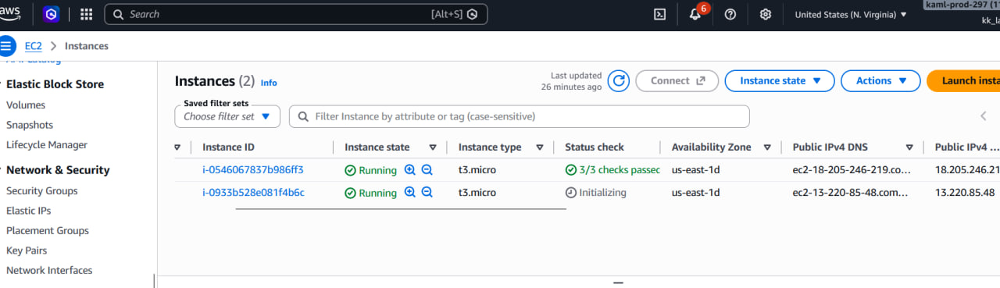
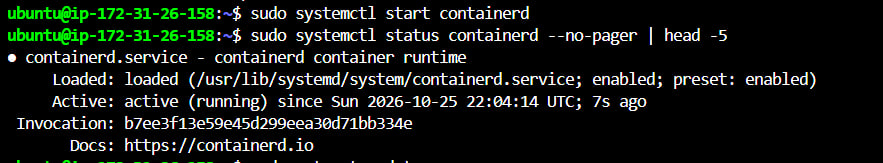
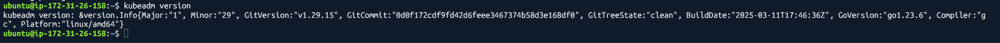
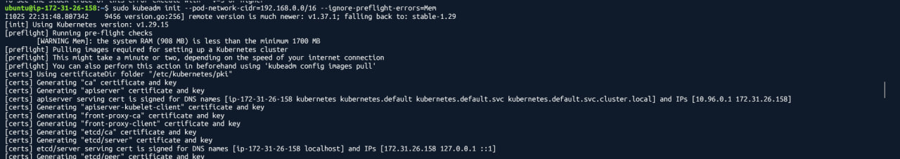
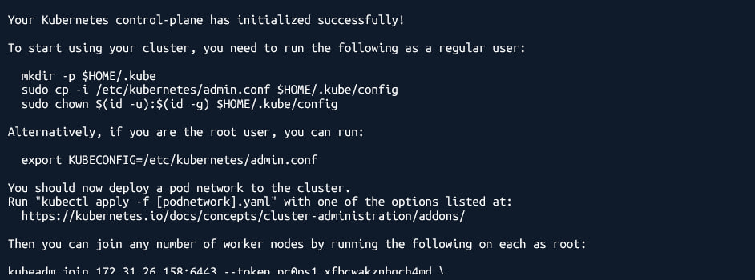
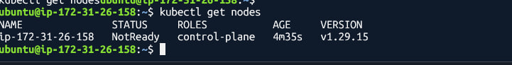
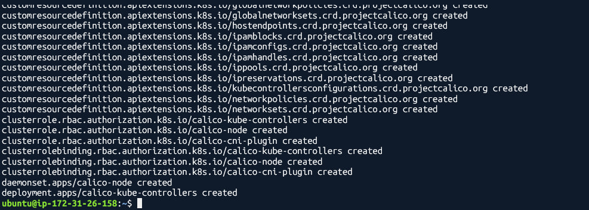
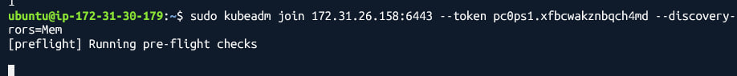
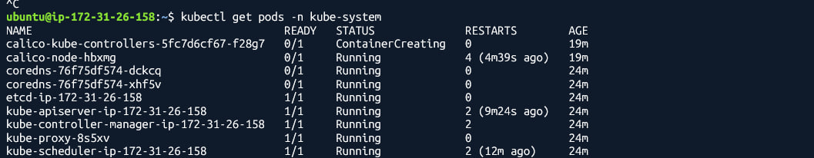

# Lab 9: Deploy Kubernetes Cluster using Kubeadm

This lab covers deploying a full Kubernetes cluster from scratch using kubeadm on AWS EC2 instances.
The cluster consists of one control plane node (master) and one worker node, connected via Calico CNI.

---

## What Was Done

- Installed and configured containerd as the container runtime on all nodes
- Installed kubeadm, kubelet, and kubectl on both nodes
- Initialized the control plane using kubeadm init
- Installed Calico CNI for pod networking
- Joined the worker node to the cluster
- Verified all cluster components are running

---

## Infrastructure

| Node | Role | Public IP | Private IP |
|------|------|-----------|------------|
| k8s-master | Control Plane | 18.205.246.219 | 172.31.26.158 |
| k8s-worker | Worker | 13.220.85.48 | 172.31.30.179 |

Both instances run Ubuntu 22.04 LTS on AWS EC2 (t3.micro) in us-east-1.

---

## Step 1: Launch EC2 Instances on AWS

Two EC2 instances were created on AWS Console with the following config:

- OS: Ubuntu 22.04 LTS
- Instance Type: t3.micro
- Storage: 20 GB
- Security Group: SSH (port 22) + All Traffic from Anywhere
- Key Pair: k8s.pem



Both instances are in Running state with their public IPs assigned.

---

## Step 2: Configure Kernel Modules and Sysctl (Both Nodes)

Before installing anything, kernel modules and network settings must be configured.

```
cat <<EOF | sudo tee /etc/modules-load.d/k8s.conf
overlay
br_netfilter
EOF

sudo modprobe overlay
sudo modprobe br_netfilter

cat <<EOF | sudo tee /etc/sysctl.d/k8s.conf
net.bridge.bridge-nf-call-iptables  = 1
net.bridge.bridge-nf-call-ip6tables = 1
net.ipv4.ip_forward                 = 1
EOF

sudo sysctl --system
```

---

## Step 3: Install and Start containerd (Both Nodes)

containerd is the container runtime required by Kubernetes.

```
sudo apt-get update
sudo apt-get install -y containerd

sudo mkdir -p /etc/containerd
containerd config default | sudo tee /etc/containerd/config.toml
sudo sed -i 's/SystemdCgroup = false/SystemdCgroup = true/' /etc/containerd/config.toml

sudo systemctl restart containerd
sudo systemctl enable containerd
```

After starting containerd, the service status was verified:



containerd is active and running successfully on the master node.

---

## Step 4: Install kubeadm, kubelet, and kubectl (Both Nodes)

```
sudo mkdir -p /etc/apt/keyrings
curl -fsSL https://pkgs.k8s.io/core:/stable:/v1.29/deb/Release.key | sudo gpg --dearmor -o /etc/apt/keyrings/kubernetes-apt-keyring.gpg

echo 'deb [signed-by=/etc/apt/keyrings/kubernetes-apt-keyring.gpg] https://pkgs.k8s.io/core:/stable:/v1.29/deb/ /' | sudo tee /etc/apt/sources.list.d/kubernetes.list

sudo apt-get update
sudo apt-get install -y kubelet kubeadm kubectl
sudo apt-mark hold kubelet kubeadm kubectl
```

kubeadm version was confirmed after installation:



kubeadm v1.29.15 is installed and ready on the master node.

---

## Step 5: Initialize the Control Plane (Master Only)

kubeadm init was run on the master node to bootstrap the Kubernetes control plane.

```
sudo kubeadm init --pod-network-cidr=192.168.0.0/16 --ignore-preflight-errors=Mem
```

The initialization process generates all certificates, configs, and starts the control plane components:



After completion, the control plane initialized successfully:



The output provides the join command to use on worker nodes, and kubectl config instructions.

kubectl was then configured to communicate with the cluster:

```
mkdir -p $HOME/.kube
sudo cp -i /etc/kubernetes/admin.conf $HOME/.kube/config
sudo chown $(id -u):$(id -g) $HOME/.kube/config
```

---

## Step 6: Verify Master Node Status

After kubectl was configured, the node status was checked:



The master node shows NotReady at this stage because the CNI plugin has not been installed yet.

---

## Step 7: Install Calico CNI (Master Only)

Calico is the pod networking plugin that enables communication between pods across nodes.

```
kubectl apply -f https://raw.githubusercontent.com/projectcalico/calico/v3.27.0/manifests/calico.yaml
```

All Calico resources were created successfully:



---

## Step 8: Join the Worker Node

On the worker node, the kubeadm join command from Step 5 was executed:

```
sudo modprobe br_netfilter
echo 1 | sudo tee /proc/sys/net/bridge/bridge-nf-call-iptables

sudo kubeadm join 172.31.26.158:6443 --token pc0ps1.xfbcwakznbqch4md \
    --discovery-token-ca-cert-hash sha256:e8a27acacc4bf350a48c06479a884a666e0572f9f0848fdda7d202f307e81f87 \
    --ignore-preflight-errors=Mem
```

The worker started the preflight checks and joined the cluster:



---

## Step 9: Verify Cluster Components

All kube-system pods were checked on the master node:



The core components are all running:

| Component | Status |
|-----------|--------|
| etcd | Running |
| kube-apiserver | Running |
| kube-controller-manager | Running |
| kube-scheduler | Running |
| kube-proxy | Running |
| calico-node | Running |
| coredns | Running |

---

## Issues Encountered and Solutions

| Issue | Solution |
|-------|----------|
| containerd inactive after install | sudo systemctl start containerd |
| ERROR Mem during kubeadm init | Added --ignore-preflight-errors=Mem |
| containerd.io not found on Ubuntu 26 | Used containerd package instead of containerd.io |
| br_netfilter missing on worker | sudo modprobe br_netfilter before kubeadm join |
| kubectl TLS timeout | Added swap with fallocate to free RAM |
| dpkg lock error | sudo dpkg --configure -a then retry |

---

## Result

The Kubernetes cluster was successfully deployed using kubeadm with:

- 1 Control Plane node running all core components
- 1 Worker node joined to the cluster
- Calico CNI installed for pod networking
- kubectl configured and communicating with the cluster

The cluster is ready to schedule and run workloads across both nodes.
